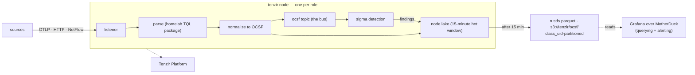

# Tenzir

> **Navigation**: [← Observability](../README.md) | [Core node](./nodes/core/README.md) | [Tetragon node](./nodes/tetragon/README.md) | [Detections](./detections/README.md) | [Upstream docs](https://tenzir.com/docs/)

Two standalone Tenzir nodes in namespace `tenzir-system`; Tenzir has no
distributed mode, so each node is a process with its own lake and its own
pipelines. The [core node](./nodes/core/README.md) is the detection plane:
it normalizes kube-apiserver audit, authentik, fleet, trivy, and NetFlow
feeds to a unified OCSF bus, runs one sigma pass over it, and owns the
archive. The [tetragon node](./nodes/tetragon/README.md) owns only the
tetragon export flood, so its CPU and memory behavior cannot starve
detection.

Both nodes register into one hosted Tenzir Platform workspace
(app.tenzir.com) over a single outbound WebSocket. Pipelines run entirely
on the nodes; the events flowing through them never route through the
platform.

## Architecture

Three planes: live detection runs in-node (feeds publish OCSF events onto
the bus, sigma evaluates them as they arrive); findings and events live in
the one OCSF dataset at `s3://tenzir/ocsf/`, class-partitioned parquet on
rustfs; querying and alerting live in Grafana over MotherDuck, which reads
the parquet directly. Grafana owns notifications; there is no other
findings egress. The class taxonomy and the bus semantics live in
[`detections/README.md`](./detections/README.md).



The chart is the whole topology: feeders, the bus, sigma, the lake, the
archive, and the Grafana query plane. Nothing else consumes findings.

## Secrets

1Password item `tenzir-secrets` (`vaults/Secrets/items/tenzir-secrets`)
renders the `tenzir-secrets` Secret. Vault field labels are kebab-case
and the rendered Secret keys match them:

- `aws-access-key-id` / `aws-secret-access-key`: rustfs bucket-scoped
  user for the `tenzir` bucket (see the [rustfs bucket/user creation
  doc](../../../../../docs/infrastructure/rustfs-bucket-user-creation.md);
  bucket and user creation is an operator step)
- `discord-webhook-url`: unused by the manifests; the vault field stays
  for the operator's off-repo use
- `authentik-events-token`: the ak-tenzir events pull token, minted by
  the tofu pair ([`crossplane.yaml`](./crossplane.yaml) +
  [`authentik.tf`](./authentik.tf)); the operator copies the key into the
  vault after the first apply
- `core-token` / `tetragon-token`: the pre-provisioned Tenzir Platform
  node tokens, one per node

## Content

| Path                | Purpose                                                                                                            |
| ------------------- | ------------------------------------------------------------------------------------------------------------------ |
| `packages/homelab/` | TQL mapping package (`homelab`): OTLP parse, OCSF maps, the findings uid stamp, with tests                         |
| `detections/sigma/` | Sigma rules evaluated over the bus: homelab starters (OCSF field paths) + vendored SigmaHQ kubernetes-audit corpus |
| `detections/yara/`  | YARA scaffold: pinned signature-base submodule plus a vendored subset; no consumer pipeline yet                    |

Everything ships as ConfigMaps (`configMapGenerator` in
[`kustomization.yaml`](./kustomization.yaml)) and mounts read-only into
the nodes' pods. Sigma hot-reloads rule files; mapping-package changes
need a pod restart.

### Running the package tests

```sh
TENZIR_BINARY="uvx tenzir@6.19.1" \
  uvx tenzir-test --root ./flux/manifests/03-services/observability/tenzir/packages
```

Pin the runner to the deployed engine version (the node image lives in
the node HelmReleases); the runner banner confirms the pin on every run.
All baselines must stay warning-free.

## Storage lifecycle

The local lakes keep 15 minutes; every OCSF class that can name itself
archives to the one rustfs dataset at `s3://tenzir/ocsf/` as
class-partitioned parquet and expires locally. The lake is a transit
buffer between ingest and the archive, not a query surface; the parquet
is the record. DuckDB and MotherDuck read it as one table:

```sql
read_parquet('s3://tenzir/ocsf/**/*.parquet', hive_partitioning = true,
             union_by_name = true)
```

Detail lives in the node READMEs.
