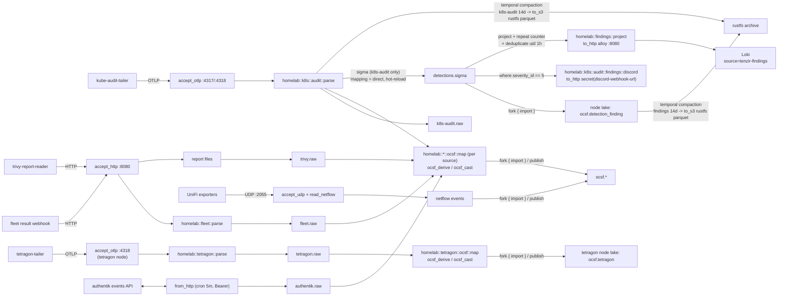

# Tenzir

> **Navigation**: [← Observability](../README.md) | [SIEM plan](../../../../../docs/plans/siem-on-lgtm.md) | [Upstream docs](https://tenzir.com/docs/)

The SIEM plan document ships separately from this MR (the operator is deciding
whether it rides along); the link resolves once it lands on main.

Tenzir runs two standalone nodes (no distributed mode; each node is a
silo with its own store and queries). The core node
(`tenzir-node-default`) is the SIEM detection plane: it normalizes
kube-apiserver audit, authentik, fleet, trivy, and NetFlow data to OCSF,
runs Sigma rules on the audit stream, stores the matched Detection
Findings as the immutable record, and ships a flat, query-optimized
projection of them to Loki (the `tenzir-findings` stream — the searchable
surface for pull-side triage; the uid fingerprint joins both stores).
CRITICAL findings doorbell to Discord. Loki stays the system of record;
the core node is the detection horizon (hot storage plus a 14-day rolling
window before export to rustfs). The heavy tetragon node
(`tenzir-node-tetragon-default`) runs only the tetragon ingest + OCSF
pipelines: the 2026-10-12/13 OOM cycle showed the tetragon export flood
starving the combined node (CPU pinned at the 1-core limit, OOMKilled
twice in 45 min), so the flood got its own node — tetragon data lives in
its own node store now.

- Namespace: `tenzir-system` (two standalone nodes, no Tenzir Platform)
- Nodes: core `tenzir-node-default` (k8s-audit ingest, sigma detections,
  findings, netflow, authentik, fleet, trivy, http-ingest) and tetragon
  `tenzir-node-tetragon-default` (tetragon ingest + OCSF only; heavy
  resources, subprocess pipelines)
- Chart: `oci://ghcr.io/tenzir/charts/tenzir-node` (see
  [`helmrelease.yaml`](./helmrelease.yaml) and
  [`helmrelease-tetragon.yaml`](./helmrelease-tetragon.yaml))
- Collector feeds: [`../kube-audit-tailer/`](../kube-audit-tailer/)
  pushes OTLP/HTTP to the core `accept_otlp` listeners (4317/4318);
  [`../tetragon-tailer/`](../tetragon-tailer/) pushes to the tetragon
  node's `accept_otlp` listener (4318); the fleet result webhook and the
  [trivy-report-reader](../../trivy/) POST to the `http-ingest` listener
  (8080); UniFi exporters send NetFlow to the `netflow` port (2055/UDP)
  behind [`tenzir-ingest-lb`](./service-ingest.yaml) on the shared ingest
  pool IP
- Upstream: <https://github.com/tenzir/tenzir>

## Pipeline



## Content

| Path                              | Purpose                                                                                                                                               |
| --------------------------------- | ----------------------------------------------------------------------------------------------------------------------------------------------------- |
| `packages/homelab/`               | TQL mapping package (`homelab`): OTLP parse, OCSF map, Discord embed formatting, findings projection (Loki mirror), with tests                        |
| `sigma/sigmahq/kubernetes-audit/` | Vendored subset of the 16 SigmaHQ `kubernetes/audit` rules, re-copied from the [`third-party/sigmahq`](../../../../../third-party/sigmahq/) submodule |
| `sigma/own/`                      | Homelab starter rules                                                                                                                                 |

Everything ships as ConfigMaps (`configMapGenerator` in
[`kustomization.yaml`](./kustomization.yaml)) and is mounted read-only into
both nodes' pods. Sigma hot-reloads rule files; mapping-package changes
additionally need a pod restart (bounce the affected node's StatefulSet —
core or tetragon — after editing TQL operators).

### Running the package tests

The tests run with the tenzir-test harness, which invokes a `tenzir` binary
resolved from `TENZIR_BINARY`, then `PATH`, then `uvx tenzir` (the latest
engine release — no local install needed). Pin the runner to the deployed
engine version and run from the repo root:

```sh
TENZIR_BINARY="uvx tenzir@6.19.1" \
  uvx tenzir-test --root ./flux/manifests/03-services/observability/tenzir/packages
```

`helmrelease.yaml` deploys `tenzir/tenzir:v6.19.1`; bump the runner pin when
the node image moves. The runner banner confirms the version on every run:
`1× tenzir (v6.19.1)`. All baselines must stay warning-free — `ocsf_cast`
schema warnings are the mapping's "not done" signal.

## Secrets

1Password item `tenzir-secrets` (`vaults/Secrets/items/tenzir-secrets`)
renders the `tenzir-secrets` Secret with:

- `AWS_ACCESS_KEY_ID` / `AWS_SECRET_ACCESS_KEY` — rustfs bucket-scoped user
  for the `tenzir` bucket (see
  [rustfs bucket/user creation](../../../../../docs/infrastructure/rustfs-bucket-user-creation.md);
  bucket + user creation is an operator step)
- `DISCORD_WEBHOOK_URL` — webhook bound to the Discord security channel
  (channel `1558191196482830488`)

## Storage lifecycle

- Core node PVC: 20Gi, Longhorn default class; disk budgets 18GiB high /
  16GiB low (oldest data is erased at the ceiling)
- Tetragon node PVC: own 20Gi store
  (`state-tenzir-node-tetragon-default-0`) with the same 18GiB/16GiB
  budgets; space-only compaction — no archive rule yet (tetragon OCSF is
  the 14d detection horizon, not a record; Loki keeps the raw stream)
- NetFlow volume baseline (goflow2 handoff): two active UniFi exporters
  (~1.8 kB/s combined when measured at the 2026-10-10 swap) — negligible
  against the budget; re-baseline if exporters change
- After 14 days (event time), `plugins.compaction.time` on the core node
  exports
  `ocsf.api_activity` events as parquet to
  `s3://tenzir/ocsf/{uuid}.parquet` and Detection Findings to
  `s3://tenzir/findings/{uuid}.parquet` on rustfs, consuming the originals
  (`tenzir-ctl compaction list` shows both rules; `tenzir-ctl compaction
run k8s-audit-archive` forces a cycle for testing)

## Known limitations

- The chart schema requires `nodes[].token`; each standalone node uses an
  empty `TENZIR_TOKEN` (`node-token.yaml`, `node-token-tetragon.yaml`) — a
  node with no token never connects to the platform
- Audit events are detected on the raw schema (SigmaHQ `kubernetes/audit`
  rules name raw audit fields and are not in the OCSF projection catalog);
  OCSF mapping runs in parallel for storage and investigation
- No per-source provenance beyond the audit pipeline: `receiver.peer_ip` is
  dropped after parse; the Loki pivot is labels + timestamp + auditID
- NetFlow, authentik, fleet, trivy, and tetragon OCSF events have no sigma
  detections yet — detection content covers `ocsf.api_activity` (6003) and
  the sigma findings (`ocsf.detection_finding`, both archived to rustfs);
  the disk budget (18 GiB high) is the backstop for the rest
- Fleet rows map to the OCSF Base Event: a row's meaning comes from its
  query, and no scheduled query existed at mapping time — grow
  [`fleet/ocsf/map.tql`](./packages/homelab/operators/fleet/ocsf/map.tql)
  into a per-query dispatch as queries land
- The trivy-report-reader only watches `vulnerability_reports/` and
  `secret_reports/` (the two report kinds with a named OCSF class);
  config-audit/rbac/infra/compliance/SBOM files stay on the PVC (Loki
  keeps the webhook copies)

## Troubleshooting

```sh
kubectl exec -n tenzir-system tenzir-node-default-0 -- \
  tenzir -e localhost:5158 \
  'metrics "pipeline" | summarize ingress_events=sum(ingress.events), pipeline_id'
kubectl logs -n tenzir-system tenzir-node-default-0 | grep -i error
# recent stored events
kubectl exec -n tenzir-system tenzir-node-default-0 -- \
  tenzir -e localhost:5158 \
  'export | head 5'
# tetragon node (tetragon ingest + OCSF only — no detections/findings)
kubectl exec -n tenzir-system tenzir-node-tetragon-default-0 -- \
  tenzir -e localhost:5158 \
  'metrics "pipeline" | summarize ingress_events=sum(ingress.events), pipeline_id'
kubectl logs -n tenzir-system tenzir-node-tetragon-default-0 | grep -i error
```
