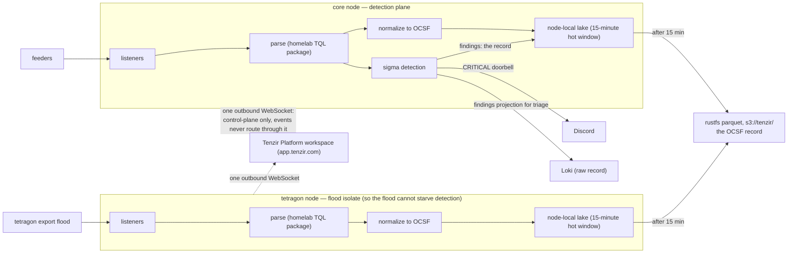

# Tenzir

> **Navigation**: [← Observability](../README.md) | [Core node](./core/README.md) | [Tetragon node](./tetragon/README.md) | [SIEM plan](../../../../../docs/plans/siem-on-lgtm.md) | [Upstream docs](https://tenzir.com/docs/)

The SIEM plan document ships separately from this tree; the link resolves
once it lands on main.

Two standalone Tenzir nodes in namespace `tenzir-system`; Tenzir has no
distributed mode, so each node is a process with its own lake and its own
pipelines. The [core node](./core/README.md) is the detection plane: it
normalizes kube-apiserver audit, authentik, fleet, trivy, and NetFlow
feeds to OCSF, runs sigma rules over the audit stream, and owns the
findings egress (Discord doorbell for CRITICAL, Loki projection for
triage, rustfs parquet as the record). The [tetragon
node](./tetragon/README.md) owns only the tetragon export flood, so its
CPU and memory behavior cannot starve detection.

Both nodes register into one hosted Tenzir Platform workspace
(app.tenzir.com) over a single outbound WebSocket. Pipelines run entirely
on the nodes; the events flowing through them never route through the
platform.

## Architecture

A Tenzir node is a standalone process with TQL pipelines and its own
node-local lake; listeners (`accept_otlp`, `accept_http`, `read_netflow`)
feed pipelines that parse, normalize to OCSF, detect, and egress. The
chart shows the shape both nodes share and the roles they split — core as
the detection plane, tetragon as the flood isolate, so the export flood
cannot starve detection; per-node wiring (ports, pipelines, sources)
lives in each deployment's own connectivity chart:
[core](./core/README.md), [tetragon](./tetragon/README.md).



## Secrets

1Password item `tenzir-secrets` (`vaults/Secrets/items/tenzir-secrets`)
renders the `tenzir-secrets` Secret. Vault field labels are kebab-case
and the rendered Secret keys match them:

- `aws-access-key-id` / `aws-secret-access-key`: rustfs bucket-scoped
  user for the `tenzir` bucket (see the [rustfs bucket/user creation
  doc](../../../../../docs/infrastructure/rustfs-bucket-user-creation.md);
  bucket and user creation is an operator step)
- `discord-webhook-url`: webhook bound to the Discord security channel
- `authentik-events-token`: the ak-tenzir events pull token, minted by
  the tofu pair ([`crossplane.yaml`](./crossplane.yaml) +
  [`authentik.tf`](./authentik.tf)); the operator copies the key into the
  vault after the first apply
- `core-token` / `tetragon-token`: the pre-provisioned Tenzir Platform
  node tokens, one per node

## Content

| Path                              | Purpose                                                                                                                                            |
| --------------------------------- | -------------------------------------------------------------------------------------------------------------------------------------------------- |
| `packages/homelab/`               | TQL mapping package (`homelab`): OTLP parse, OCSF maps, Discord embed formatting, findings projection, with tests                                  |
| `sigma/sigmahq/kubernetes-audit/` | Vendored subset of the SigmaHQ `kubernetes/audit` rules, re-copied from the [`third-party/sigmahq`](../../../../../third-party/sigmahq/) submodule |
| `sigma/homelab/`                  | Homelab starter rules                                                                                                                              |

Everything ships as ConfigMaps (`configMapGenerator` in
[`kustomization.yaml`](./kustomization.yaml)) and mounts read-only into
the nodes' pods. Sigma hot-reloads rule files; mapping-package changes
also need a pod restart.

### Running the package tests

```sh
TENZIR_BINARY="uvx tenzir@6.19.1" \
  uvx tenzir-test --root ./flux/manifests/03-services/observability/tenzir/packages
```

Pin the runner to the deployed engine version (the node image lives in
the node HelmReleases); the runner banner confirms the pin on every run.
All baselines must stay warning-free.

## Storage lifecycle

The local lakes keep 15 minutes; everything older archives to rustfs
parquet under `s3://tenzir/` and expires locally. The lake is a transit
buffer between ingest and the archive, not a query surface; the parquet
is the record: query it back with `from_s3`. Detail lives in the node
READMEs.
