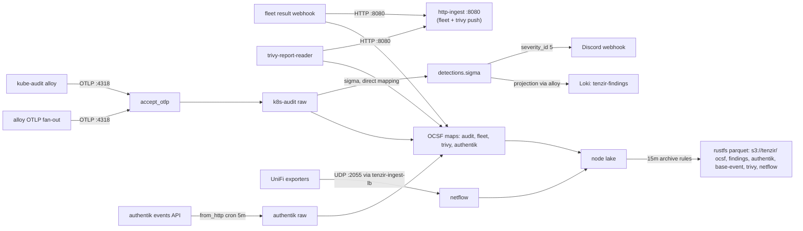

# Tenzir core node

> **Navigation**: [← Tenzir](../README.md) | [Tetragon node](../tetragon/README.md) | [Upstream docs](https://tenzir.com/docs/)

The detection plane: one process (HelmRelease `tenzir-node`, rendering
pod `tenzir-node-core`) that normalizes kube-apiserver audit,
authentik, fleet, trivy, and NetFlow feeds to OCSF, runs the sigma rule
corpus over the raw audit stream, and owns every findings egress.
Twelve pipelines live in [`helmrelease.yaml`](./helmrelease.yaml); the
manifest is the source of truth for tunables (sizes, limits, retention
values, ports).

- k8s-audit-ingest-http / k8s-audit-ingest-grpc: OTLP listeners for the
  kube-audit alloy and the alloy log fan-out
- k8s-audit-ocsf, authentik-ocsf, fleet-ocsf, trivy-ocsf: per-source
  OCSF mapping into the lake
- k8s-audit-sigma: sigma detection over the raw audit stream
  (direct field mapping, hot-reloaded)
- netflow-collector: NetFlow v5/v9/IPFIX from the UniFi exporters
- http-ingest: fleet webhook and trivy-report-reader payloads
- authentik-events: cron pull of the authentik events API
- findings-discord / findings-loki: the CRITICAL doorbell and the Loki
  projection

## Connectivity



## Sizing

The upstream size-a-node formula, with this node's inputs. Limits that
follow from it live in [`helmrelease.yaml`](./helmrelease.yaml); inputs
marked assumed wait for post-recovery re-measurement.

```text
CPU = max(2, ceil(
    1 / 250        # ingest ~1 GB/day raw (assumed; netflow measured at 0.15 GB/day)
    + 5 * 0.1      # 5 sources: audit OTLP, authentik API, fleet, trivy, netflow (docs: 0.1 per source)
    + 3 * 0.1      # 3 destinations: rustfs S3, Discord, Loki (docs: 0.1 per destination)
    + 5 * 0.2      # normalization on: OCSF maps on audit, authentik, fleet, trivy (docs: 0.2 per source)
    + 1            # detection on: sigma over the audit stream (docs: +1)
)) = max(2, ceil(2.804)) = 3 cores
```

```text
Storage = 1 * 30 * (1/2880) / 10 / 1000  # ingest GB/day * days/mo * months (15 min = 1/2880 mo) / Zstd 10x / GB to TB
        = 0.000001 TB (~1 MB for the full 15-minute window)
```

```text
RAM = max(2,
    0.000001 * 2   # catalog term: 2 GB per TB retained (docs); ~0 at a 15-minute window
    + 8 * 0.1      # sources (5) + destinations (3)
    + 0            # enrichment off (no context operators)
    + 1            # detection state (docs: +1)
) = max(2, 1.800002) = 2 GB
```

The memory limit doubles the 2 GB floor as burst and import-buffer
headroom; the CPU limit matches the formula. Re-measure both after
recovery and adjust in the manifest, not here.

## Retention

15-minute local horizon; the rustfs parquet archive is the record. Every
stored type has an archive rule at `after: 15 minutes` in
[`helmrelease.yaml`](./helmrelease.yaml): the rule exports the events as
parquet to its `s3://tenzir/<prefix>/` and consumes the originals
(archive-then-expire; `preserve-input` stays off). NetFlow's stored
schema is `netflow.v9`, live-confirmed on the running node (2026-10-15,
read-only catalog query). The reader nests the datagram time under the
`netflow` record, so the rule spells its qualified path
`field: netflow.export_time` (live-probed: the bare leaf matches 0
events, the dotted path resolves). The flow records carry no OCSF-style
`time` field. The compaction pass runs every 5 minutes, so the true
window at pass boundaries is 15-20 minutes.

The lake is a transit buffer between ingest and the archive, not a query
surface: it is sized to hold one window at worst-case flood rate, and the
parquet plus `from_s3` is the queryable history.

Horizon math, same inputs as the sizing block:

```text
Core (assumed ~1 GB/day raw ingest):
  1 GB/day raw / 10                # Zstd ~10x reduction (docs default)
  ~ 100 MB/day on disk             # on-disk rate after the reduction above
  100 MB/day / 96                  # 15-minute horizon (96 windows per day)
  ~ 1 MB peak local footprint      # vs the 18 GiB disk budget: never binds
```

The disk budgets (18 GiB high / 16 GiB low) are the backstop for
archive-rule failure windows, not the front door; the time rules are the
front door. A stalled archive cycle grows the lake slowly enough that
the budget erases oldest long before the PVC fills, and the S3 archive
keeps the record once the cycle resumes.

Naming note: the entry rename (`default` → `core`) orphans the live
`state-tenzir-node-default-0` PVC at rollout and the lake re-wipes
fresh — accepted; the rustfs parquet is the record, and
`persistence.existingClaim` can adopt the old PVC if the lost hot window
ever matters.

## Adding a node

1. **Folder**: create `tenzir/<role>/` with `kustomization.yaml`,
   `helmrelease.yaml`, `README.md`.
2. **Token**: provision a node in the app.tenzir.com workspace and add
   its `tnz_...` token as a field on the `tenzir-secrets` 1Password
   item, labeled `<role>-token` (same convention as `core-token` /
   `tetragon-token`). The hosted platform issues per-node tokens only;
   workspace tokens are Sovereign-only.
3. **HelmRelease**: `metadata.name: tenzir-node-<role>`, chart
   `tenzir-node` from the `tenzir` HelmRepository, image pinned with the
   renovate comment, `nodes[0].name: <role>` — the entry name is the
   node name, because the chart renders every node resource as
   `<fullname>-<entry.name>`; every release except the literally named
   `tenzir-node` also takes `fullnameOverride: tenzir-node` (fullname
   otherwise defaults to the release name, which doubles the role when
   the release contains `tenzir-node` and prepends the chart name when it
   does not — never rename a release into either concat trap),
   `nodes[0].token.existingSecret: tenzir-secrets` plus
   `nodes[0].token.key: <role>-token`, `extraPorts` for the node's
   listeners, `persistence.size` per sizing.
4. **Size it** with the size-a-node formula using measured ingest;
   requests small, limits justified.
5. **Retention**: disk budgets on its PVC plus `plugins.compaction`
   (weighted-age space rules as the backstop, archive-then-expire time
   rules for every record type it stores).
6. **Catalog knobs**: the `tenzir.index` block from this node's
   [`helmrelease.yaml`](./helmrelease.yaml) (lazy-sketches, load
   concurrency 4).
7. **Egress**: if the node runs detections, copy the `findings-*`
   pipeline shapes from this node and give it its own S3 archive prefix
   `s3://tenzir/<role>/`.
8. **Content**: if the node mounts package or sigma files, add the
   `configMapGenerator` entries at the root kustomization (files stay in
   the shared `packages/` tree) plus subPath `extraVolumeMounts` in the
   node's HelmRelease.
9. **Feeder wiring**: point feeders at
   `tenzir-node-<role>.tenzir-system.svc.cluster.local:<port>`;
   the chart auto-generates the Service.
10. **Root kustomization**: add `- <role>` to `resources:`.
11. **README**: sizing math, retention profile, and this recipe.

## Troubleshooting

```sh
kubectl exec -n tenzir-system tenzir-node-core-0 -- \
  tenzir -e localhost:5158 \
  'metrics "pipeline" | summarize ingress_events=sum(ingress.events), pipeline_id'
kubectl logs -n tenzir-system tenzir-node-core-0 | grep -i error
# recent stored events
kubectl exec -n tenzir-system tenzir-node-core-0 -- \
  tenzir -e localhost:5158 'export | head 5'
```
