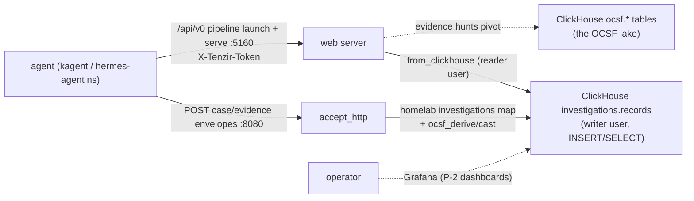

# Tenzir investigations node

> **Navigation**: [← Tenzir](../README.md) | [Core node](../core/README.md) | [Tetragon node](../tetragon/README.md) | [Upstream docs](https://tenzir.com/docs/)

One process (HelmRelease `tenzir-node-investigations`, rendering pod
`tenzir-node-investigations`) that owns the investigations plane and
nothing else: durable OCSF-modeled case and evidence records in
ClickHouse, written by agents, read by the operator in Grafana. Two
lanes, one blast radius:

- **Write lane** — the standing
  [`investigations-ingest-http`](./pipelines/investigations-ingest-http.tql)
  pipeline: agents POST thin JSON envelopes to `accept_http :8080`; the
  [`homelab::investigations::ocsf::map`](../../packages/homelab/operators/investigations/ocsf/README.md)
  operator validates the envelope and stamps the OCSF spine, and the
  `to_clickhouse` leg INSERTs into `investigations.records` with the
  INSERT/SELECT-scoped `investigations-writer` user. No archive rule and
  no local import: the node lake stays empty by construction and
  ClickHouse is the only durable copy.
- **Query lane** — the node REST API (web server `:5160`,
  `/api/v0/pipeline/launch` + `/api/v0/serve`, `X-Tenzir-Token` auth):
  agents launch bounded `from_clickhouse` pipelines over
  `investigations.records` and the raw `ocsf.*` lake tables with the
  SELECT-scoped `investigations-reader` user. ClickHouse credentials
  never reach the agents — the node resolves `secret(...)` node-side.

The query lane is IN-CLUSTER ONLY (operator decision, investigations
design): no Gateway route, no HTTPRoute. Agents in the `kagent` and
`hermes-agent` namespaces reach
`tenzir-node-investigations.tenzir.svc.cluster.local:{8080,5160}`
directly; the chart NetworkPolicy scopes who may call.

## Envelope contract

Agents POST to `:8080`; every envelope names `kind`. Case envelopes map
to Incident Finding (2005) lifecycle records, evidence envelopes to
Datastore Activity (6005, Query) pins:

```text
{"kind": "case", "action": "open",   "case_uid"?: <minted when absent>, "title": ...,
 "desc"?, "severity_id"?, "assignee"?, "related_events"?, "time"?}
{"kind": "case", "action": "update", "case_uid": ..., "status_id"?, "severity_id"?,
 "assignee"?, "notes"?, "finding_info_list"? (full state from the last read-back), "time"?}
{"kind": "case", "action": "close",  "case_uid": ..., "verdict_id": ..., "desc"?, "time"?}
{"kind": "evidence", "case_uid": ..., "query_string": ..., "data"?, "observables"?,
 "database"?, "table"?, "agent"?: {uid, instance_uid?, model?, delegation_uid?, prompt?}, "time"?}
```

The map asserts the required pieces (`kind`, `case_uid` or a case open,
`title` on open, `verdict_id` on close, `query_string` on evidence) and
drops a malformed POST's events with assert-WARNINGS in the node
diagnostics — the POST itself still 200s (`accept_http` default), so the
agent's write confirmation is the query-lane read-back, not the POST
response. `metadata.correlation_uid` is the case spine on every record;
evidence `observables[].event_uid` links the raw lake rows the pinned
snapshot came from. Free-text close disposition rides `desc` — `verdict`
is the caption sibling of `verdict_id` and is derived, not carried.

## Connectivity



## Containment stack

- `disable-plugins: [shell, python, to_file]` + `no-location-overrides`:
  an injected pipeline definition cannot execute commands, run Python,
  or write files. The egress trio (`to_http`/`to_s3`/`to_tcp`) is the
  open denylist decision ([`helmrelease.yaml`](./helmrelease.yaml)).
- ClickHouse users with grants only — `investigations-writer` INSERT +
  SELECT (SELECT for the to_clickhouse DESCRIBE refresh),
  `investigations-reader` SELECT on `investigations.*` + `ocsf.*`; no
  ALTER/TRUNCATE/DROP for either. Wipe is not a permitted operation.
- Chart NetworkPolicy: ingress from the agent namespaces and
  same-namespace pods only.
- Append-only records: the residual risk floor is visible, attributed,
  easily-recoverable pollution — not destruction. The
  `record_integrity` attestation placeholder and its P-2 verification
  lane are tracked in
  `docs/issues/tenzir-record-integrity-attestations.md`.

## Bootstrap order

1. **Vault fields** on the `tenzir-secrets` item: `investigations-token`
   (platform node token, below) and, later in this sequence,
   `investigations-api-token`. On the `clickhouse-secrets` item:
   `clickhouse-investigations-writer-password` and
   `clickhouse-investigations-reader-password` (values for the CHI users
   block in `clickhouse/cluster/cluster.yaml`; git only names the
   fields).
2. **Platform node token**: provision a node in the app.tenzir.com
   workspace and copy its `tnz_...` token into the
   `investigations-token` field — the HelmRelease reads it via
   `nodes[].token`.
3. **Apply**: the node boots with the write lane; the web server start
   command fails its config validation until the TLS TODO below lands
   (server mode requires the certfile/keyfile pair) — the node keeps
   running, see the bootstrap note in
   [`helmrelease.yaml`](./helmrelease.yaml).
4. **Generate the API token** (operator-side, once — web-server tokens
   are node state on the PVC, not config):

   ```sh
   kubectl exec -n tenzir tenzir-node-investigations-0 -- \
     tenzir-ctl web generate-token
   ```

   `tenzir` alone is the pipeline runner (one pipeline argument, no
   subcommands) — the control binary is `tenzir-ctl`, which ships in the
   node image (`/nix/store/...-tenzir-6.19.1/bin/tenzir-ctl`, verified
   live on the core node) and also runs from a workstation as
   `uvx --from tenzir@6.19.1 tenzir-ctl` against an endpoint.

5. **Vault copy**: paste the printed token into the
   `investigations-api-token` field of the `tenzir-secrets` item and hand
   that field to the investigator agent. The token persists on the PVC
   (the step is not re-needed on pod rolls, only on PVC loss).

## Sizing

The upstream size-a-node formula at investigations volume (near zero):
1 source (accept_http) + 1 destination (ClickHouse) + normalization
(0.1 + 0.1 + 0.2) -> the formula's `max(2, ·)` floor pins 2 cores and
the 2 GB RAM floor (catalog term ~0 at an empty lake). Limits live in
[`helmrelease.yaml`](./helmrelease.yaml); requests stay small.

## Retention

None locally — no lake to retain. The PVC carries node state only
(platform registration, web-token state, diagnostics) at a 5Gi cap; the
record is `investigations.records` on ClickHouse, which has **no TTL by
design**: a case record is a durable audit record. The tiered storage
policy rides for consistency with the lake tables, but no TTL clause
ever moves or deletes a part.

## Known limitations

- **Web-server TLS pair pending** — the `certfile`/`keyfile` TODO in
  [`helmrelease.yaml`](./helmrelease.yaml): server mode fails validation
  without the pair, so the query lane boots only after the cert-manager
  Certificate lands. The write lane is unaffected.
- **Static API token, no per-caller identity** — attribution is
  record-level (envelope fields + `ai_operation` stamping), not
  caller-level; per-caller tokens are the upgrade path.
- **No Grafana surface yet** — the P-2 case dashboards need a one-line
  extension of the `grafana` user's grants (SELECT on `investigations.*`
  in the CHI users block, a P-2 change); until then the store is
  reachable only via in-cluster reads with the `investigations-reader`
  user.
- **Attestations are a placeholder** — see the containment section; the
  P-2 verification lane owns the fingerprint chain.

## Troubleshooting

```sh
kubectl exec -n tenzir tenzir-node-investigations-0 -- \
  tenzir -e localhost:5158 'metrics "pipeline"'
kubectl logs -n tenzir tenzir-node-investigations-0 | grep -i error
# assert warnings from malformed envelopes
kubectl logs -n tenzir tenzir-node-investigations-0 | grep -i warning
```
