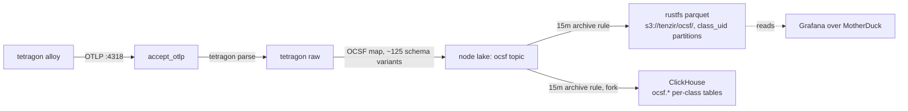

# Tenzir tetragon node

> **Navigation**: [← Tenzir](../README.md) | [Core node](../core/README.md) | [Upstream docs](https://tenzir.com/docs/)

One process (HelmRelease `tenzir-node-tetragon`, rendering pod
`tenzir-node-tetragon`) that owns the tetragon export flood and
nothing else. Two pipelines live in
[`helmrelease.yaml`](./helmrelease.yaml): tetragon-ingest-http (the
OTLP listener for the tetragon alloy) and tetragon-ocsf (the OCSF
mapping into the lake). The split exists so the flood's CPU and memory
behavior cannot starve the detection plane on the core node.

The chart runs the pipelines in subprocesses (`pipeline-subprocesses`):
a pipeline blowup dies alone instead of taking the node process down,
and the `accept_otlp` listener stays in-process by design. Both
pipelines carry `// parallelism: 4`, matching the node's 4-core limit;
the parse and OCSF-map chains replicate across cores while the listener
and `import` stay single-instance regardless of the directive. Parallel
instances emit in arbitrary order, which is harmless while both
pipelines stay per-event. If windowed or sequence detections land here
later, drop the directive on the affected pipeline or scope it with
`parallel N { ... }` and keep the order-sensitive part outside it.

## Connectivity



The unmapped residue on every mapped event is a selected projection (pod
identity, kprobe policy name), not the full raw record: re-storing the
raw tetragon event duplicated every process object at ~4.8 KB per event
of pure lake cost (measured live, 2026-10-15 rate diagnosis). The
OCSF-mapped fields carry the process identity, endpoints, files, and
containers; the residue keeps only what no OCSF field carries.

## Sizing

The upstream size-a-node formula at the flood peak (the sizing case):
a steady-state estimator run with this node's burst inputs. Limits live
in [`helmrelease.yaml`](./helmrelease.yaml).

```python
CPU = max(2, ceil(
    69 / 250       # flood ingest ~69 GB/day raw: 800 ev/s (peak measured) * ~1,000 B (docs EDR range, assumed)
    + 1 * 0.1      # 1 source: the tetragon alloy OTLP stream (docs: 0.1 per source)
    + 1 * 0.1      # 1 destination: rustfs S3 archive (docs: 0.1 per destination)
    + 1 * 0.2      # normalization on: OCSF fan-out (docs: 0.2 per source)
    + 0            # detection off
)) = max(2, ceil(0.676)) = 2 cores
```

```python
Storage = 69 * 30 * (1/2880) / 10 / 1000 # flood GB/day * days/mo * months (15 min = 1/2880 mo) / Zstd 10x / GB to TB
        = 0.0000719 TB by formula
```

```python
RAM = max(2,
    0.0000719 * 2  # catalog term: 2 GB per TB retained (docs); ~0 at a 15-minute window
    + 2 * 0.1      # sources (1) + destinations (1)
    + 0            # no detection, no enrichment
) = 2 GB
```

The node keeps its limits (4 cores, 12Gi) well above the formula on
live-verified burst evidence: the flood working set measured 12.1Gi at
the ceiling, and a 1-core drain cap once turned flood backpressure into
memory growth. The formula prices steady state; this node exists for
floods.

## Retention

Same 15-minute horizon as the core node, same archive: the tetragon OCSF
classes (Process Activity 1007, File System Activity 1001, Network
Activity 4001) export to the one dataset at `s3://tenzir/ocsf/` with
class_uid partitions at `after: 15 minutes` and then expire locally
(archive-then-expire; `preserve-input` off). The Base Event fallback
for unknown export kinds cannot name a class and is not archived: it
expires with the window on the weighted-age backstop. The lake is a
transit buffer between ingest and the archive, not a query surface.
The parquet is the OCSF record past the window; the compaction pass
runs every 5 minutes, so the true window at pass boundaries is 15-20
minutes. The Longhorn volume sits out the daily-backup RecurringJob
([`storage.yaml`](./storage.yaml)): a daily chain of
a 15-minute buffer is redundant with the parquet record. Filesystem trim
and snapshot hygiene still run on the volume. No raw tetragon JSON is
kept anywhere past the window (the export-stdout sidecar is gone; the
OCSF parquet is the record); replay the record with `from_s3`.

Dual-write transition window (MR-3): the same rule forks a
`to_clickhouse` leg ahead of the unchanged `to_s3` tail, so every
archived batch also lands in the per-class `ocsf.<Class_Name>` tables on
the ClickHouse OCSF store — `mode="append"` fails loudly if the DDL is
missing, and `max_batch_rows=65536` (default 1s `batch_timeout`) bounds
the insert buffers on the flood classes. The parquet lane stays the
record until the MR-5 cut-over.

Horizon math (flood rate measured 2026-10-12; steady state assumed):

```python
Tetragon flood (measured on-disk rate):
  6.25 GiB / 2 days = 80% of volume      # 50,747 process_activity partitions (measured)
  ~ 7.8 GiB / 2 days ~ 3.9 GiB/day total   # full-volume rate implied by the 80% share (measured)
  3.9 GiB/day / 96 ~ 42 MiB              # 15-minute flood window: ~0.7% of the 6 GiB budget

Tetragon worst case (transit-buffer bound, operator-measured drain):
  253 GB/day / 96 ~ 2.6 GB raw           # the lake holds one window at worst-case flood rate:
                                         # a 15-minute buffer a 12Gi node can never OOM on again

Tetragon steady state (assumed):
  3.9 GiB/day / 96 ~ 42 MiB              # steady-state 15-minute peak footprint
                                         # egress tcp_connect rides along now: the transport-side
                                         # drop is gone, Network Activity 4001 archives too
```

The disk budgets (6 GiB high / 4 GiB low) are the backstop for
archive-rule failure windows; the time rule is the front door. The old
18/16 corridor was sized for a 24-hour horizon and left the eraser
effectively unreachable on a 20Gi PVC; at the 15-minute reality:

```python
  6 GiB high  = 30% of the 20Gi PVC                  # single-digit, reachable, leaves the PVC as the second backstop
  4 GiB low    = the erase target                     # a 2 GiB corridor so one eraser pass reclaims real space
  worst stall  ~ 2.6 GB / 15 min (extreme drain)      # the corridor tolerates several stalled windows before erasing
```

## Known detection noise

The secret-file-access kprobe stream is mostly operational PAM noise,
not detections: opencti-redis (DRAGONFLY image) runs a su-based
healthcheck loop walking `/etc/pam.d` and shadow at several events per
second, and firecrawl postgres wrappers do similar. Measured residual
egress baseline over ~3.5 days: host `?` 3.9M, qbittorrent 2.3M, slskd
1.6M, archiveteam-warrior 1.3M. Threshold or triage work on these
classes starts from that baseline, not from zero.

## Adding a node

1. **Folder**: create `tenzir/nodes/<role>/` with `kustomization.yaml`,
   `helmrelease.yaml`, `README.md`.
2. **Token**: provision a node in the app.tenzir.com workspace and add
   its `tnz_...` token as a field on the `tenzir-secrets` 1Password
   item, labeled `<role>-token` (same convention as `tetragon-token` /
   `core-token`). The hosted platform issues per-node tokens only;
   workspace tokens are Sovereign-only.
3. **HelmRelease**: `metadata.name: tenzir-node-<role>`, chart
   `tenzir-node` from the `tenzir` HelmRepository, image pinned with the
   renovate comment, `nodes[0].name: <role>`: the entry name is the
   node name, because the chart renders every node resource as
   `<fullname>-<entry.name>`; every release takes
   `fullnameOverride: tenzir-node` (fullname otherwise defaults to the
   release name, which doubles the role when the release contains
   `tenzir-node` and prepends the chart name when it does not, never
   rename a release into either concat trap),
   `nodes[0].token.existingSecret: tenzir-secrets` plus
   `nodes[0].token.key: <role>-token`, `extraPorts` for the node's
   listeners, `persistence.size` per sizing.
4. **Size it** with the size-a-node formula using measured ingest;
   requests small, limits justified.
5. **Retention**: disk budgets on its PVC plus `plugins.compaction`
   (weighted-age space rules as the backstop, archive-then-expire time
   rules for every record type it stores).
6. **Catalog knobs**: the `tenzir.index` block from
   [`helmrelease.yaml`](./helmrelease.yaml) (lazy-sketches, load
   concurrency 4).
7. **Archive**: the node writes into the shared `s3://tenzir/ocsf/`
   dataset with class_uid partitions; no per-node prefix. Detections run
   on the core node only; this node owns its feeds and its lake.
8. **Content**: if the node mounts package or sigma files, add the
   `configMapGenerator` entries at the root kustomization (files stay in
   the shared `packages/` tree) plus subPath `extraVolumeMounts` in the
   node's HelmRelease.
9. **Feeder wiring**: point feeders at
   `tenzir-node-<role>.tenzir.svc.cluster.local:<port>`;
   the chart auto-generates the Service.
10. **Root kustomization**: add `- nodes/<role>` to `resources:`.
11. **README**: sizing math, retention profile, and this recipe.

## Troubleshooting

```sh
kubectl exec -n tenzir tenzir-node-tetragon-0 -- \
  tenzir -e localhost:5158 \
  'metrics "pipeline" | summarize ingress_events=sum(ingress.events), pipeline_id'
kubectl logs -n tenzir tenzir-node-tetragon-0 | grep -i error
# recent stored events
kubectl exec -n tenzir tenzir-node-tetragon-0 -- \
  tenzir -e localhost:5158 'export | head 5'
```
