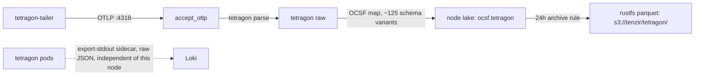

# Tenzir tetragon node

> **Navigation**: [← Tenzir](../README.md) | [Core node](../core/README.md) | [Upstream docs](https://tenzir.com/docs/)

One process (HelmRelease `tenzir-node-tetragon`, rendering pod
`tenzir-node-tetragon-default`) that owns the tetragon export flood and
nothing else. Two pipelines live in
[`helmrelease.yaml`](./helmrelease.yaml): tetragon-ingest-http (the
OTLP listener for the tetragon-tailer) and tetragon-ocsf (the OCSF
mapping into the lake). The split exists so the flood's CPU and memory
behavior cannot starve the detection plane on the core node.

The chart runs the pipelines in subprocesses (`pipeline-subprocesses`):
a pipeline blowup dies alone instead of taking the node process down,
and the `accept_otlp` listener stays in-process by design. Both
pipelines carry `// parallelism: 4`, matching the node's 4-core limit;
the parse and OCSF-map chains replicate across cores while the listener
and `import` stay single-instance regardless of the directive. Parallel
instances emit in arbitrary order, which is harmless while both
pipelines stay per-event. If windowed or sequence detections land here
later, drop the directive on the affected pipeline or scope it with
`parallel N { ... }` and keep the order-sensitive part outside it.

## Connectivity



## Sizing

The upstream size-a-node formula at the flood peak (the sizing case):
a steady-state estimator run with this node's burst inputs. Limits live
in [`helmrelease.yaml`](./helmrelease.yaml).

```text
CPU = max(2, ceil(
    69 / 250       # flood ingest ~69 GB/day raw: 800 ev/s (peak measured) * ~1,000 B (docs EDR range, assumed)
    + 1 * 0.1      # 1 source: the tetragon-tailer OTLP stream (docs: 0.1 per source)
    + 1 * 0.1      # 1 destination: rustfs S3 archive (docs: 0.1 per destination)
    + 1 * 0.2      # normalization on: OCSF fan-out (docs: 0.2 per source)
    + 0            # detection off
)) = max(2, ceil(0.676)) = 2 cores
```

```text
Storage = 69 * 30 * (1/30) / 10 / 1000   # flood GB/day * days/mo * months (1 day = 1/30 mo) / Zstd 10x / GB to TB
        = 0.0069 TB by formula
```

```text
RAM = max(2,
    0.0069 * 2     # catalog term: 2 GB per TB retained (docs); ~0 at a 24h window
    + 2 * 0.1      # sources (1) + destinations (1)
    + 0            # no detection, no enrichment
) = 2 GB
```

The node keeps its limits (4 cores, 12Gi) well above the formula on
live-verified burst evidence: the flood working set measured 12.1Gi at
the ceiling, and a 1-core drain cap once turned flood backpressure into
memory growth. The formula prices steady state; this node exists for
floods.

## Retention

Same 24-hour horizon as the core node: the tetragon OCSF types archive
to `s3://tenzir/tetragon/` as parquet at `after: 1 day` and then expire
locally (archive-then-expire; `preserve-input` off). The parquet is the
OCSF record past the window. Loki keeps the raw JSON stream via the
tetragon pods' export-stdout sidecar, but raw JSON is not
OCSF-queryable; replay the record with `from_s3`.

Horizon math (flood rate measured 2026-10-12; steady state assumed):

```text
Tetragon flood (measured on-disk rate):
  6.25 GiB / 2 days = 80% of volume      # 50,747 process_activity partitions (measured)
  ~ 7.8 GiB / 2 days ~ 3.9 GiB/day total   # full-volume rate implied by the 80% share (measured)
  3.9 GiB/day * 1 day ~ 3.9 GiB          # peak flood footprint: a fifth of the 18 GiB budget

Tetragon steady state (assumed, post-filter):
  3.9 GiB/day * 20% ~ 0.8 GiB/day        # the tailer drops the tcp_connect leg at the transport
  0.8 GiB/day * 1 day ~ 0.8 GiB          # steady-state peak footprint
```

The disk budgets (18 GiB high / 16 GiB low) are the backstop for
archive-rule failure windows; the time rule is the front door.

## Adding a node

1. **Folder**: create `tenzir/<role>/` with `kustomization.yaml`,
   `helmrelease.yaml`, `README.md`.
2. **Token**: provision a node in the app.tenzir.com workspace and add
   its `tnz_...` token as a field on the `tenzir-secrets` 1Password
   item, labeled `<role>-token` (same convention as `tetragon-token` /
   `core-token`). The hosted platform issues per-node tokens only;
   workspace tokens are Sovereign-only.
3. **HelmRelease**: `metadata.name: tenzir-node-<role>` (drives the
   rendered `tenzir-node-<role>-default` StatefulSet and Service names),
   chart `tenzir-node` from the `tenzir` HelmRepository, image pinned
   with the renovate comment, `nodes[0].token.existingSecret:
tenzir-secrets` plus `nodes[0].token.key: <role>-token`,
   `extraPorts` for the node's listeners, `persistence.size` per sizing.
4. **Size it** with the size-a-node formula using measured ingest;
   requests small, limits justified.
5. **Retention**: disk budgets on its PVC plus `plugins.compaction`
   (weighted-age space rules as the backstop, archive-then-expire time
   rules for every record type it stores).
6. **Catalog knobs**: the `tenzir.index` block from
   [`helmrelease.yaml`](./helmrelease.yaml) (lazy-sketches, load
   concurrency 4).
7. **Egress**: if the node runs detections, copy the `findings-*`
   pipeline shapes from the core node and give it its own S3 archive
   prefix `s3://tenzir/<role>/`.
8. **Content**: if the node mounts package or sigma files, add the
   `configMapGenerator` entries at the root kustomization (files stay in
   the shared `packages/` tree) plus subPath `extraVolumeMounts` in the
   node's HelmRelease.
9. **Feeder wiring**: point feeders at
   `tenzir-node-<role>-default.tenzir-system.svc.cluster.local:<port>`;
   the chart auto-generates the Service.
10. **Root kustomization**: add `- <role>` to `resources:`.
11. **README**: sizing math, retention profile, and this recipe.

## Troubleshooting

```sh
kubectl exec -n tenzir-system tenzir-node-tetragon-default-0 -- \
  tenzir -e localhost:5158 \
  'metrics "pipeline" | summarize ingress_events=sum(ingress.events), pipeline_id'
kubectl logs -n tenzir-system tenzir-node-tetragon-default-0 | grep -i error
# recent stored events
kubectl exec -n tenzir-system tenzir-node-tetragon-default-0 -- \
  tenzir -e localhost:5158 'export | head 5'
```
