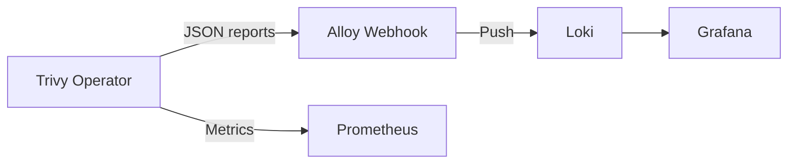

# Trivy Operator

The Trivy Operator provides continuous security scanning for Kubernetes clusters.

> **Navigation**: [← Back to Services README](../README.md)

## Overview

- Vulnerability scans for Kubernetes workloads
- Configuration audits with predefined rules or custom OPA policies
- Exposed-secret scans
- RBAC analysis
- Infrastructure assessment of core component configuration
- Compliance reports: CIS benchmarks, NSA/CISA guidance, and Pod Security Standards
- SBOM generation for workloads

## Architecture



**Key design decisions:**

- **Reports → Loki**: Security reports are sent via webhook to Alloy, which forwards them to Loki. This prevents etcd bloat from CRD storage.
- **Metrics → Prometheus**: Vulnerability metrics continue to be scraped by Prometheus via ServiceMonitor.
- **Alternate storage**: Reports are written to a small scratch PVC instead of CRDs. The PVC is just ephemeral scratch space since Loki is the source of truth.

## Querying reports in Loki

Reports can be queried in Grafana using LogQL:

```logql
{source="trivy", report_kind="VulnerabilityReport"}
```

Filter by namespace:

```logql
{source="trivy", namespace="production"}
```

## References

- **[Trivy Operator Documentation](https://aquasecurity.github.io/trivy-operator/latest/)** - Primary documentation source
- **[GitHub Repository](https://github.com/aquasecurity/trivy-operator)** - Source code and issues
- **[Helm Chart Repository](https://aquasecurity.github.io/helm-charts/)** - Helm chart documentation
