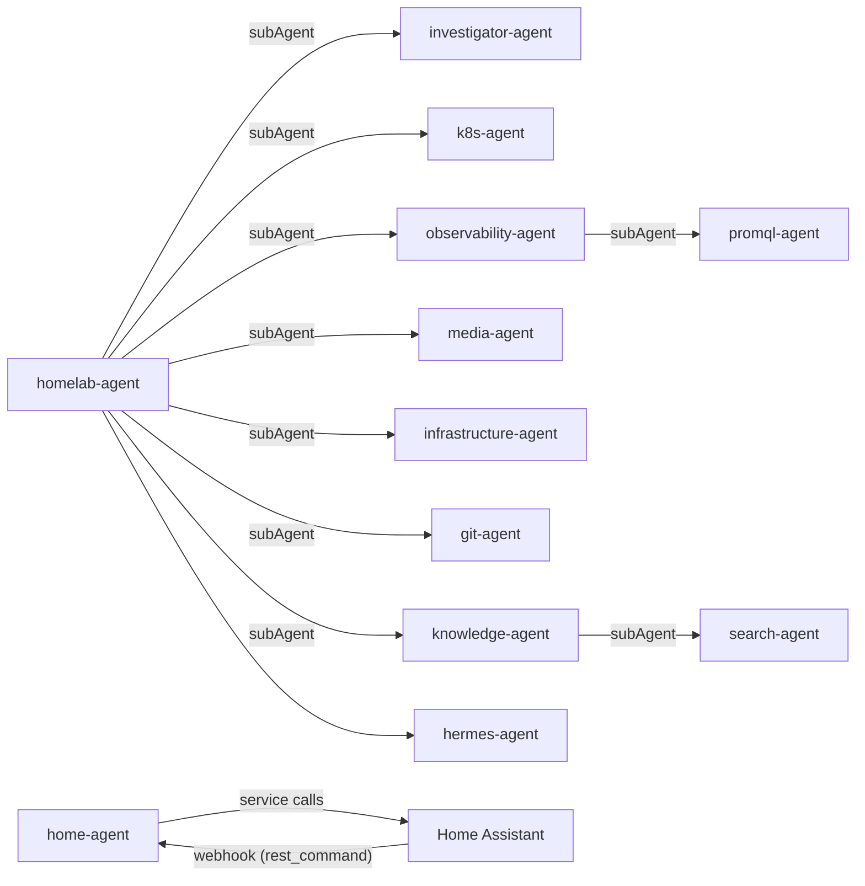

# AI Agents

Declarative AI agents orchestrated by kagent.

> **Navigation**: [← Back to AI README](../README.md)

## Overview

Every agent runs in the `kagent` namespace on the chart Harness + the
`kagent-default` WorkerPool (substrate actors, no per-agent Deployments).
The fleet consolidated into one namespace because kagent 1.0's
`tools[].subAgent` is same-namespace-only (AgentTemplate references carry no
namespace) — delegation without duplicating prompt text requires one
namespace. The seven chart subchart agents the 0.10.x line shipped
(`k8s-agent`, `promql-agent`, `observability-agent`, `helm-agent`, the three
cilium agents) are vendored at
[kagent/builtin-agents/](../kagent/builtin-agents/).

Two `agent-*` namespaces survive as bridge hosts only (no agents, no
workers): `agent-homelab` (Discord bridge) and `agent-home` (Home Assistant
webhook bridge). `investigator-agent`'s placement in `kagent` is also what the
investigations node's NetworkPolicy expects (ingress from
`kagent`/`hermes-agent` only).

**Custom Agents:**

- **[home](./home/)** - `home-agent`: Home Assistant automation (HA `rest_command` webhook bridge → A2A; HA + Grafana MCP; bridge in `agent-home`)
- **[homelab](./homelab/)** - `homelab-agent`: Tech assistant for homelab topics (Discord interface; bridge in `agent-homelab`)
- **[search](./search/)** - `search-agent`: Web search specialist using SearXNG
- **[knowledge](./knowledge/)** - `knowledge-agent`: Knowledge management with OpenZIM and Qdrant
- **[infrastructure](./infrastructure/)** - `infrastructure-agent`: Proxmox, TrueNAS, UniFi management
- **[media](./media/)** - `media-agent`: Servarr (Sonarr/Radarr) management
- **[git](./git/)** - `git-agent`: GitHub and GitLab operations
- **[investigator](./investigator/)** - `investigator-agent`: Security investigations against the Tenzir OCSF lake (cases, evidence pins, verdicts)

**Vendored builtin Agents:** [kagent/builtin-agents/](../kagent/builtin-agents/)

## Architecture

Agents are defined using kagent's declarative Agent CRD, with optional bridge components for event-driven integrations.

### Current agent delegation graph



Every edge is a same-namespace `subAgent` binding to an AgentTemplate (the
fleet shares `kagent`). Hermes calls the same agents as A2A peers.

## Adding New Agents

1. Create a new directory under `agents/`
2. Add the `AgentTemplate` (behavior: description, modelConfig, tools,
   systemPrompt), a thin `Agent` (`harnessRef: kagent-default` +
   `template.ref`), `ModelConfig`, and 1Password-backed secrets — all in the
   `kagent` namespace; wire them into the dir's `kustomization.yaml`
3. Register the agent in LiteLLM `agents:` (`agent_card_params.url`) with A2A
   URL `/api/a2a/kagent/<agent-name>`. Clients call LiteLLM native
   `POST /a2a/{agent_name}` (discover via `GET /v1/agents`).
4. Add any necessary bridge components for external integrations
5. Update this README with a link to the new agent

## Writing System Prompts

Follow the [kagent System Prompts Guide](https://kagent.dev/docs/kagent/getting-started/system-prompts):

- **Operational Protocol** - Define step-by-step methodology for the agent
- **Tool Descriptions** - Include "Use this tool when..." with trigger phrases
- **Execution Guidelines** - Explicit behavioral rules and safety guidelines

Example structure:

```yaml
systemPrompt: |
  You are a [role]. Your goal is to [purpose].

  Operational Protocol:
  1. [Step 1]
  2. [Step 2]

  Tools:
  1. tool_name
  Use when: [conditions]
  Trigger phrases: [examples]

  Execution Guidelines:
  - [Rule 1]
  - [Rule 2]
```

## Troubleshooting

```bash
# The whole agent fleet (custom + vendored builtins)
kubectl get agents --namespace kagent

kubectl logs --namespace kagent deployment/kagent-controller -f

kubectl get pods --namespace kagent -l app=a2a-gateway
```

## References

- **[Agent orchestration (A2A vs MCP)](../../../../../.agents/context/agent-orchestration.md)** - Hermes / orchestrator need→agent map and LiteLLM MCP fallbacks
- **[kagent Documentation](https://kagent.dev/docs/)** - Agent orchestration documentation
- **[Agent CRD Reference](https://kagent.dev/docs/kagent/crds)** - Custom resource definitions
- **[System Prompts Guide](https://kagent.dev/docs/kagent/getting-started/system-prompts)** - Writing effective prompts
