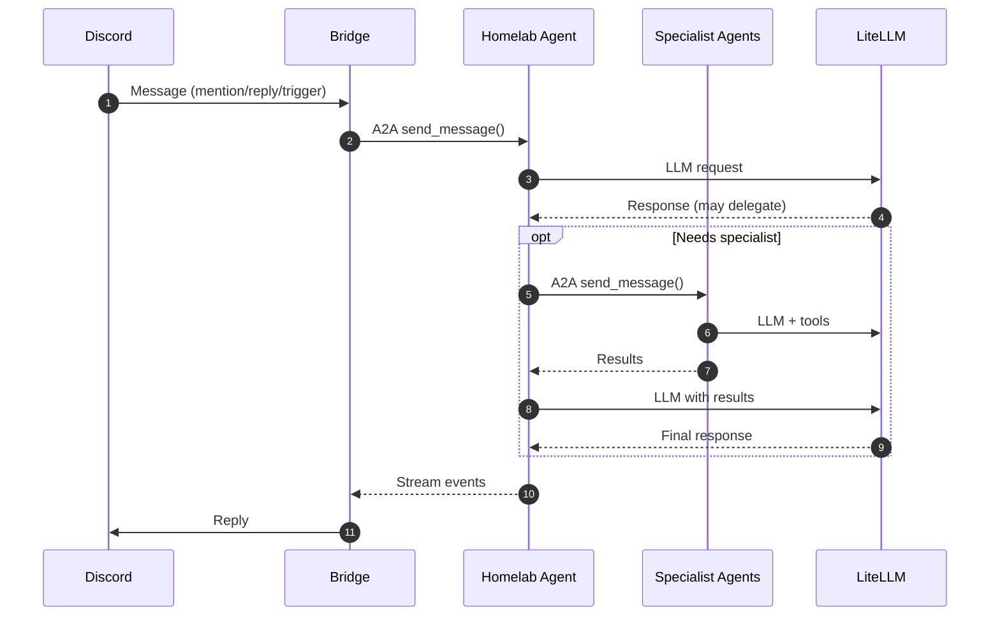

# Homelab Agent (Discord)

The homelab tech assistant, accessible via Discord. Powered by kagent.

> **Navigation**: [← Back to Agents README](../README.md)

## Overview

This deployment includes:

- kagent Agent CR (v1alpha3) in the `kagent` namespace, running on the chart Harness + WorkerPool
- Discord MCP (`mcp-discord`) for outbound messages and channel tools; `RemoteMCPServer` in `kagent`
- Discord bridge in `agent-homelab` that forwards messages to kagent via A2A
- Integration with LiteLLM for model access
- SubAgent tools (same-namespace AgentTemplates; v1alpha3 agent-tools are
  namespace-local, which is why the whole fleet consolidated into `kagent`):
  investigator, k8s, observability, media, infrastructure, git, knowledge,
  promql, search (promql and search bind directly here because kagent 1.0.1
  allows only one shared-subagent level — the specialists' templates cannot
  carry subAgent tools of their own)



## Configuration

### 1Password Secrets

Create a 1Password item:

**homelab-agent-secrets** (`vaults/Secrets/items/homelab-agent-secrets`)

- `discord-token`: Discord bot token for authentication
- `litellm-api-key`: API key for LiteLLM access

### Access

- **kagent A2A Endpoint**: `http://kagent-controller.kagent.svc.cluster.local:8083/api/a2a/kagent/homelab-agent`
- **kagent UI**: `https://kagent.gateway.services.apocrathia.com`

## Troubleshooting

### Common Issues

1. **Bridge not connecting to kagent**

   ```bash
   # Check bridge logs
   kubectl logs --namespace agent-homelab -l app.kubernetes.io/name=discord-bridge

   # Verify kagent agent is running
   kubectl get agent homelab-agent --namespace kagent
   ```

2. **Agent not responding**

   ```bash
   # Check agent status (runs live in the shared kagent-default WorkerPool)
   kubectl get agent homelab-agent --namespace kagent

   # View worker pool logs (agent sessions execute here)
   kubectl logs --namespace kagent -l ate.dev/worker-pool=kagent-default --prefix
   ```

### Health Checks

```bash
# Bridge
kubectl get pods,svc --namespace agent-homelab

# homelab-agent CR + ModelConfig
kubectl get agent homelab-agent --namespace kagent
kubectl get modelconfig homelab-agent-model --namespace kagent

# Test A2A endpoint
kubectl exec --namespace agent-homelab deploy/discord-bridge -- \
  curl -s http://kagent-controller.kagent.svc.cluster.local:8083/api/a2a/kagent/homelab-agent/.well-known/agent-card.json
```

## References

- **[kagent Documentation](https://kagent.dev/docs)** - Agent orchestration platform
- **[A2A Protocol](https://a2a-protocol.org)** - Agent-to-Agent communication protocol
- **[discord.py](https://discordpy.readthedocs.io)** - Discord bot framework
