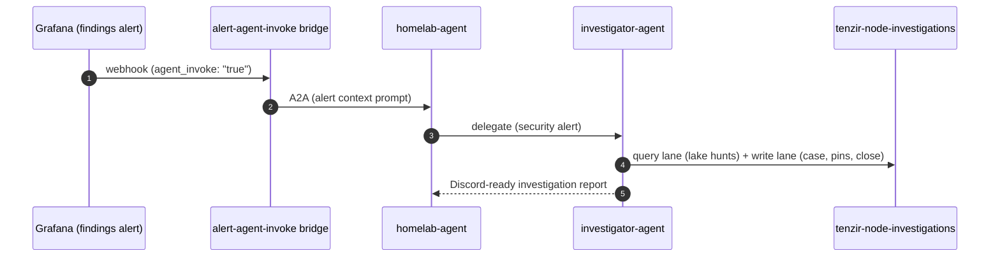

# Investigator Agent (Security)

The homelab's security investigator: a kagent agent that triages alerts and
detection findings against the Tenzir OCSF lake, works cases in the
investigations platform, and reports in Discord-ready markdown. Persona:
the [security-analyst](../../../../../.agents/agents/security-analyst/agent.md)
mold — adversarial, evidence-first, homelab-calibrated.

> **Navigation**: [← Back to Agents README](../README.md)

## What it does

Investigations are a workflow over two surfaces of the
[investigations node](../../../../security/tenzir/nodes/investigations/README.md)
(`tenzir-node-investigations`, in-cluster only):

- **Write lane** (`:8080`) — case open/update/close and evidence-pin envelopes
  into ClickHouse `investigations.records` (append-only; the map operator
  validates and stamps the OCSF spine).
- **Query lane** (`:5160`, `X-Tenzir-Token`) — bounded `from_clickhouse`
  pipelines over `investigations.records` and the `ocsf.*` lake tables with the
  SELECT-only `investigations-reader` user. ClickHouse credentials never reach
  the agent; the node resolves `secret(...)` node-side.

The full playbook (endpoints, envelope contract, launch/serve examples, the
single-JSON read trap, verdict/status IDs, report format) lives in the Agent CR
system prompt — the prompt is the skill.

## How it gets invoked



- **Alerts**: the [tenzir findings alert rule](../../../../03-services/observability/grafana/alerting/tenzir-findings.yaml)
  (`agent_invoke: "true"`) routes through the existing alert-agent-invoke
  bridge to homelab-agent, which delegates security alerts here.
- **Hermes** (the human front door) lists `investigator-agent` in its
  `a2a_agents` and can call it as a peer.
- **homelab-agent** holds it as an Agent tool and delegates security-finding
  triggers to it.

## Why it lives in the `kagent` namespace

The investigations node's NetworkPolicy allows ingress from the `kagent` and
`hermes-agent` namespaces only (the investigations design's in-cluster callers)
— the investigator was designed to land in one of those, so it deploys next to
homelab-agent rather than in a dedicated `agent-*` namespace. No cluster
manifest change was needed on the tenzir side.

## How the token reaches the agent

kagent declarative agents have no HTTP tool surface, so the agent makes its
HTTP calls from executed Python code blocks. kagent's code-execution sandbox
([`_sanitize_env`](https://github.com/kagent-dev/kagent) in kagent-skills)
strips secret-named env vars (`*TOKEN*`, `*SECRET*`, `*API_KEY*`,
`*PASSWORD*`) out of executed code's environment — an env-var token would be
invisible to the code that needs it. So the token rides a secret volume
instead:

- `tenzir-secrets` (the shared vault item) renders in-namespace via an
  OnePasswordItem CR; the Agent CR projects only the
  `investigations-api-token` key into the pod (secret-volume `items` filter),
  read-only at `/etc/tenzir/investigations-api-token`.
- `spec.sandbox.network.allowedDomains` pins sandbox egress to the
  investigations node's Service DNS name (kagent denies sandbox egress by
  default).

## Secrets bootstrap

Two 1Password items (fields named here; values added by the operator):

| Item (`vaults/Secrets/items/…`) | Field                      | Consumer                                                                       |
| ------------------------------- | -------------------------- | ------------------------------------------------------------------------------ |
| `investigator-agent-secrets`    | `litellm-api-key`          | ModelConfig → cluster LiteLLM                                                  |
| `tenzir-secrets`                | `investigations-api-token` | the node web-API token (node README bootstrap step 4-5; node state on the PVC) |

## Access

- **kagent A2A endpoint**: `http://kagent-controller.kagent.svc.cluster.local:8083/api/a2a/kagent/investigator-agent`
- **LiteLLM A2A entry**: `investigator-agent` in `litellm.yml` `agents:`
- **Hermes peer entry**: `a2a_agents.investigator-agent` in hermes `config.yaml`

## Troubleshooting

```bash
kubectl get agent investigator-agent --namespace kagent
kubectl get pods --namespace kagent -l kagent.dev/agent-name=investigator-agent
kubectl logs --namespace kagent -l kagent.dev/agent-name=investigator-agent

# Does the mounted token exist in the pod?
kubectl exec --namespace kagent deploy/investigator-agent -- \
  cat /etc/tenzir/investigations-api-token
```

Assert-WARNINGS from dropped envelopes surface in the node's diagnostics; the
findings alert lane surfaces alert-invocation failures in the bridge logs
(`alert-agent-invoke`, namespace `agent-tasks`).

## Known limitations

- **Code-execution runtime risk**: the Agent CR sets `executeCodeBlocks: true`
  (wired through the kagent controller to the sandboxed local code executor),
  but the kagent 0.10.x CRD notes the field is ignored "for now" over an
  upstream adk-python code-executor bug. If a code block does not execute on
  the live agent, this is the first suspect — verify with a direct A2A ask
  like "read the token file and GET the node's `/api/v0/ping`" before filing.
- **Static bearer token, no per-caller identity** — the platform's accepted
  residual risk (investigations design); attribution is record-level via the
  envelope `agent` object.
- **High-severity case re-trigger**: case opens with `severity_id >= 4` match
  the findings alert too; the playbook's dedupe step (continue, never re-open)
  is the loop guard.

## References

- **[Investigations node README](../../../../security/tenzir/nodes/investigations/README.md)** — envelope contract, bootstrap, containment
- **[Tenzir platform design](../../../../../../.scratch/agent-investigation/design.md)** — P-3 scope
- **[kagent Agent CRD](https://kagent.dev/docs/kagent/crds)** — Declarative agent schema
