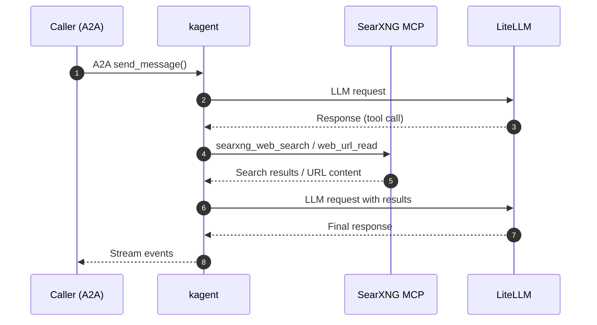

# Search Agent

Web search specialist powered by kagent, backed by SearXNG.

> **Navigation**: [← Back to Agents README](../README.md)

## Overview

This deployment includes:

- `AgentTemplate` + thin `Agent` in the `kagent` namespace (the consolidated
  agent fleet) with a search-focused system prompt
- Connection to the SearXNG and Firecrawl MCP servers for web search
- Integration with LiteLLM for model access
- Bound as a same-namespace subAgent tool by knowledge-agent



## Tools

### SearXNG MCP

The agent uses the kagent `MCPServer` in `mcp-searxng` namespace:

- **Tools**:
  - `searxng_web_search` - Web search with pagination, time filtering, language selection
  - `web_url_read` - Read and convert URL content to markdown
- **Backend**: SearXNG instance at `http://searxng.searxng.svc.cluster.local:8080`

## Configuration

### 1Password Secrets

Create a 1Password item:

**search-agent-secrets** (`vaults/Secrets/items/search-agent-secrets`)

- `litellm-api-key`: API key for LiteLLM access

### Access

- **kagent A2A Endpoint**: `http://kagent-controller.kagent.svc.cluster.local:8083/api/a2a/kagent/search-agent`
- **kagent UI**: `https://kagent.gateway.services.apocrathia.com`

## Agent-to-Agent Integration

Other agents delegate to this agent via a same-namespace `subAgent` tool
binding (v1alpha3 agent-tools are namespace-local; the whole fleet shares the
`kagent` namespace):

```yaml
spec:
  template:
    inline:
      tools:
        - subAgent:
            name: search-agent
            description: Search the web for current information, documentation, news, and technical details.
            templateRef:
              name: search-agent
```

The calling agent's LLM sees the binding `description` field to decide when to
delegate. knowledge-agent holds this binding today.

## Troubleshooting

### Common Issues

1. **Agent not responding**

   ```bash
   # Check agent status
   kubectl get agent search-agent --namespace kagent

   # Compiled sandbox + worker pool (substrate agents share them)
   kubectl get sandboxtemplates -n kagent
   kubectl get workerpool -n kagent
   ```

2. **MCP Server not working**

   ```bash
   # Check MCPServer status
   kubectl get mcpserver -n mcp-searxng searxng

   # View MCP server pod logs
   kubectl logs -n mcp-searxng -l app.kubernetes.io/instance=searxng
   ```

### Health Checks

```bash
# Overall status
kubectl get agent,modelconfig --namespace kagent

# Test A2A endpoint
curl -s http://kagent-controller.kagent.svc.cluster.local:8083/api/a2a/kagent/search-agent/.well-known/agent-card.json
```

## References

- **[kagent Documentation](https://kagent.dev/docs)** - Agent orchestration platform
- **[A2A Protocol](https://a2a-protocol.org)** - Agent-to-Agent communication protocol
- **[SearXNG](https://docs.searxng.org/)** - Privacy-respecting metasearch engine
