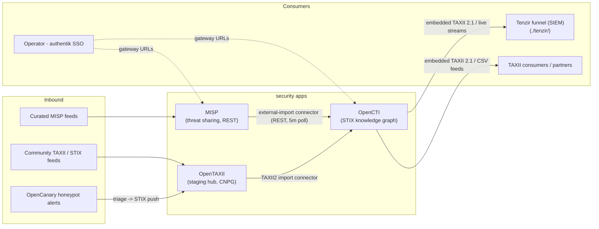

# Security

Threat-intelligence and detection platforms for the homelab.

> **Navigation**: [← Back to Apps README](../README.md)

## Applications

### [MISP](./misp/README.md)

MISP threat-intelligence sharing platform (open source): curated feeds, event
and indicator management, community sharing, and enrichment via misp-modules.
MariaDB + valkey are in-cluster subchart dependencies; authentik OIDC SSO is
included with the local login kept as break-glass.

### [OpenCTI](./opencti/README.md)

OpenCTI threat-intelligence knowledge platform (open source): STIX 2.1
knowledge graph, dashboards, investigations, and a connector ecosystem. A
single-node OpenSearch, rabbitmq, and dragonfly run as subchart dependencies;
object storage rides the NAS rustfs bucket `opencti-files`. Authentik SSO and
the MISP import connector are included.

### [OpenAEV](./openaev/README.md)

OpenAEV (Open Adversarial Exposure Validation, formerly OpenBAS) is Filigran's
open-source exposure-validation platform: attack simulation campaigns and
tabletop exercises with defense coverage measurement — the attack-side sibling
of OpenCTI. Runs as four generic-app workloads (platform, OpenSearch engine,
RabbitMQ, CNPG PostgreSQL) with Authentik OIDC SSO and NAS rustfs object
storage.

### [OpenCanary](./opencanary/README.md)

Lightweight honeypot emulating HTTP and SSH services, generating attacker
alerts for the threat-intel pipeline.

### [OpenTAXII](./opentaxii/README.md)

TAXII 2.1 server for STIX indicator exchange, backed by CloudNativePG, feeding
the MISP/OpenCTI pipeline. It exists to feed OpenCTI a distinct, manageable
feed: an on-ramp that turns any in-lab STIX producer (canary triage, MISP
push, future scripts) into one authenticated TAXII 2.1 collection the existing
taxii2 connector imports, keeping producers decoupled from OpenCTI's API and
token. Why a separate hub: OpenCTI's embedded TAXII server is outbound-only
(it serves the graph; it does not accept pushes), so inbound STIX otherwise
means OpenCTI API scripts; there is no off-the-shelf OpenCanary connector in
the OpenCTI catalog (180 external-import connectors checked); and OpenTAXII
keeps TAXII 1.x and 2.1 storage disjoint, so the hub role is specifically the
TAXII 2.1 side.

### [Prism](./prism/README.md)

Self-hosted OSINT scanner: domain, IP, email, phone, and username
reconnaissance across 26 modules with OPSEC scoring, entity graphs, and
report exports. Single FastAPI container, no database; JSON-file persistence
on Longhorn.

### [Tenzir](./tenzir/README.md)

SIEM detection + investigations plane: six standalone Tenzir nodes that
normalize kube-apiserver audit, tetragon, authentik, fleet, trivy, and
NetFlow feeds to a unified OCSF bus, run SigmaHQ + homelab Sigma rules
over it, and archive findings into the ClickHouse datalake after a
15-minute hot window. The ClickHouse cluster is nested under the tenzir
tree ([`tenzir/clickhouse/`](./tenzir/clickhouse/README.md) — the OCSF
lake and the single-JSON-column investigations store); the Altinity
operator managing it stays at
[`03-services/clickhouse/`](../../03-services/clickhouse/README.md).
Grafana owns querying and alerting over the `ocsf-clickhouse` datasource.

## Overview

Security tooling that consumes or produces threat intelligence lives here.
Deployed via Flux; external access goes through the `main-gateway` with Gateway
API HTTPRoutes, hostnames under `security.gateway.services.apocrathia.com` are
reserved but app routes follow the `<app>.gateway.services.apocrathia.com`
convention.

## Threat-intel flow

Normalization is the graph: MISP events and external STIX both land in
OpenCTI, which is the single source of TAXII 2.1 for downstream consumers.
OpenTAXII is the on-ramp for anything that speaks STIX but is neither MISP
nor OpenCTI. OpenCanary alerts flow Loki-side for now; the STIX push path
is aspirational until a triage script exists.

## References

- **[MISP](https://www.misp-project.org/)** - Threat sharing platform
- **[cmu-sei/misp-helm](https://github.com/cmu-sei/misp-helm)** - Helm chart consumed via GitRepository
- **[OpenCTI](https://opencti.io/)** - Threat-intelligence knowledge platform
- **[devops-ia/helm-opencti](https://github.com/devops-ia/helm-opencti)** - Helm chart from its published repository
- **[Generic-App Chart](../../../../helm/generic-app/README.md)** - Application deployment template
