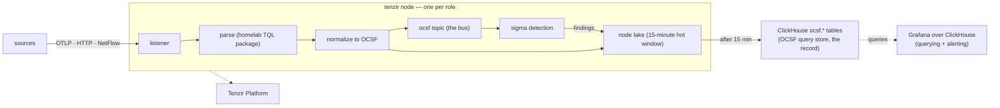

# Tenzir

> **Navigation**: [← Security](../README.md) | [Core node](./nodes/core/README.md) | [Tetragon node](./nodes/tetragon/README.md) | [Netflow node](./nodes/netflow/README.md) | [Investigations node](./nodes/investigations/README.md) | [Enrichment node](./nodes/enrichment/README.md) | [Introspection node](./nodes/introspection/README.md) | [Intel node](./nodes/intel/README.md) | [ClickHouse datalake](./clickhouse/README.md) | [Detections](./detections/README.md) | [.agents](./.agents/README.md) | [Upstream docs](https://tenzir.com/docs/)

Seven standalone Tenzir nodes in namespace `tenzir`; Tenzir has no
distributed mode, so each node is a process with its own lake and its own
pipelines. The [core node](./nodes/core/README.md) is the detection plane:
it normalizes kube-apiserver audit, authentik, fleet, and trivy feeds to
a unified OCSF bus, runs one sigma pass over it, and owns the
archive. The [tetragon node](./nodes/tetragon/README.md) owns only the
tetragon export flood, and the [netflow node](./nodes/netflow/README.md)
owns only the NetFlow collector (UniFi exporters behind
`tenzir-ingest-lb`), so neither feed's lifecycle can starve or disturb
detection. The [investigations node](./nodes/investigations/README.md)
owns the agent investigations plane: case/evidence envelopes in,
`investigations.records` on ClickHouse out — an isolated blast radius the
detection plane never shares. The [enrichment
node](./nodes/enrichment/README.md) is the internal-reference-data
factory: it builds the curated lookup tables — fleet assets,
baselines — into ClickHouse for the other nodes to pull; its first
lane, the hourly Fleet host-inventory pull into `ocsf.fleet_assets`,
shipped in lap 2 (the core node's loader is the consumer half).
The [introspection
node](./nodes/introspection/README.md) is the introspection plane:
every node ships its own pipeline diagnostics to Loki and Mimir
through its node-config lane pair (B1 — the introspection node's pair
covers its own pipelines, and the central poller Deployment is
retired), and the node's charter direction is inward detection —
scheduled volume/freshness passes over the ocsf.\* tables landing
operational findings.
The [intel node](./nodes/intel/README.md) is the CTI factory plane: its
opencti-taxii-factory-walk and opencti-taxii-factory-poll pipelines
pull OpenCTI's TAXII 2.1 indicator collection into the
`ocsf.OSINT_Inventory_Info` ClickHouse table (single pane: all CTI
reaches tenzir via OpenCTI) on the rc engine image, and
the core node's
[opencti-osint-loader](./nodes/core/pipelines/opencti-osint-loader.tql)
is the consumer half.

All seven nodes register into one hosted Tenzir Platform workspace
(app.tenzir.com) over a single outbound WebSocket. Pipelines run entirely
on the nodes; the events flowing through them never route through the
platform.

## Architecture

Three planes: live detection runs in-node (feeds publish OCSF events onto
the bus, sigma evaluates them as they arrive); findings and events live in
the ClickHouse OCSF query store (per-class `ocsf.<Class_Name>` tables);
querying and alerting live in Grafana over the `ocsf-clickhouse`
datasource. Grafana owns notifications; there is no other findings
egress. The class taxonomy and the bus semantics live in
[`detections/README.md`](./detections/README.md).

The parquet lane is retired (rollout MR-5 teardown, plan
[`docs/plans/clickhouse-rollout.md`](../../../../../docs/plans/clickhouse-rollout.md)):
the nodes' `ocsf-archive` rules write ClickHouse alone, and the existing
`s3://tenzir/ocsf/` archive stays untouched in the rustfs bucket as
frozen, unqueried history — deleting it is a separate operator call. No
backfill replays it into ClickHouse (operator decision 2026-10-17: the
parquet history has no value to preserve).



The chart is the whole topology for detection: feeders, the bus, sigma, the
lake, the archive, and the Grafana query plane. The one agent-side consumer
is the [investigator agent](../../artificial-intelligence/agents/investigator/README.md)
(P-3): high-severity findings alert through Grafana with the `agent_invoke`
label ([findings alert rule](../../../03-services/observability/grafana/alerting/tenzir-findings.yaml))
and reach it via the bridge → homelab-agent delegation, and it works cases
against `investigations.records` + `ocsf.*` through the
[investigations node](./nodes/investigations/README.md)'s write and query lanes.

## Secrets

1Password item `tenzir-secrets` (`vaults/Secrets/items/tenzir-secrets`)
renders the `tenzir-secrets` Secret. Vault field labels are kebab-case
and the rendered Secret keys match them:

- `aws-access-key-id` / `aws-secret-access-key`: rustfs bucket-scoped
  user for the `tenzir` bucket; the ClickHouse cold tier reads them as
  `CH_S3_ACCESS_KEY_ID` / `CH_S3_SECRET_ACCESS_KEY` (the clickhouse
  namespace renders the same item from
  [`clickhouse/secret.yaml`](./clickhouse/secret.yaml); see the
  [rustfs bucket/user creation
  doc](../../../../../docs/infrastructure/rustfs-bucket-user-creation.md)
  for the original provisioning)
- `discord-webhook-url`: unused by the manifests; the vault field stays
  for the operator's off-repo use
- `authentik-events-token`: the ak-tenzir token for the core node's
  `authentik-pull` pipeline, minted by the tofu pair
  ([`crossplane.yaml`](./crossplane.yaml) +
  [`authentik.tf`](./authentik.tf)); the operator copies the key into the
  vault after the first apply
- `core-node-token` / `tetragon-node-token` / `netflow-node-token` / `investigations-node-token` /
  `enrichment-node-token` / `introspection-node-token` / `intel-node-token`: the
  pre-provisioned Tenzir Platform node tokens, one per node
- `opencti-taxii-token`: the OpenCTI TAXII 2.1 bearer token, written
  by the opencti lane — its slice-7 handoff
  ([`docs/issues/opencti-deployment.md`](../../../../../docs/issues/opencti-deployment.md));
  the intel node's opencti-taxii-factory-walk and
  opencti-taxii-factory-poll pipelines read it
  (`TENZIR_SECRETS__OPENCTI_TAXII_TOKEN` on tenzir-node-intel)

A second item, `clickhouse-secrets`, renders the `clickhouse-secrets`
Secret in this namespace (MR-3; since the ClickHouse store relocated
into this namespace 2026-10-27, this is the item's only render — the
CHI in [`clickhouse/`](./clickhouse/) reads it too, for its users block).
Its `clickhouse-password`
field is the ClickHouse `tenzir` writer password five nodes read as
`TENZIR_SECRETS__CLICKHOUSE_PASSWORD` — the `to_clickhouse` archive legs
on core, tetragon, and netflow, and the factory INSERT legs on
enrichment and intel; its `clickhouse-investigations-{writer,reader}-password` fields carry the
investigations node's two ClickHouse users (see
[`secret.yaml`](./secret.yaml) and the node README). The operator adds
the values.

## Content

| Path                | Purpose                                                                                                            |
| ------------------- | ------------------------------------------------------------------------------------------------------------------ |
| `packages/homelab/` | TQL mapping package (`homelab`): OTLP parse, OCSF maps, the findings uid stamp, with tests                         |
| `packages/netflow/` | Vendored library `netflow` package: NetFlow v5/v9/IPFIX → OCSF Network Activity (netflow node ingest)              |
| `packages/stix/`    | Vendored library `stix` package: TAXII 2.1 fetch + STIX Indicator → OCSF OSINT Inventory Info (intel node factory) |
| `packages/tenzir/`  | Vendored library `tenzir` utilities: the OSINT pair (`update_context` / `enrich`) this lane wires core-side        |
| `clickhouse/`       | The ClickHouse datalake: CHI + Keeper CRs, extracted server config, the single-JSON-column investigations store    |
| `detections/sigma/` | Sigma rules evaluated over the bus: homelab starters (OCSF field paths) + vendored SigmaHQ kubernetes-audit corpus |
| `detections/yara/`  | YARA scaffold: pinned signature-base submodule plus a vendored subset; no consumer pipeline yet                    |

Everything ships as ConfigMaps (`configMapGenerator` in
[`kustomization.yaml`](./kustomization.yaml)) and mounts read-only into
the nodes' pods. Sigma hot-reloads rule files; mapping-package changes
need a pod restart.

### Running the package tests

```sh
TENZIR_BINARY="uvx tenzir@6.19.1" \
  uvx tenzir-test --root ./flux/manifests/04-apps/security/tenzir/packages
```

Pin the runner to the deployed engine version (the node image lives in
the node HelmReleases); the runner banner confirms the pin on every run.
All baselines must stay warning-free.

## Storage lifecycle

The local lakes keep 15 minutes; the mappable OCSF classes archive to
the ClickHouse OCSF query store (per-class
`ocsf.<Class_Name>` tables) and expire locally — on core the Base Event
fallback archives with them, while tetragon's unknown export kinds stay
unarchived and expire with the window. The lake is a transit
buffer between ingest and the archive, not a query surface; ClickHouse is
the record. The retired `s3://tenzir/ocsf/` parquet archive stays
untouched in the rustfs bucket as frozen history (deleting it is a
separate operator call).

Detail lives in the node READMEs.
