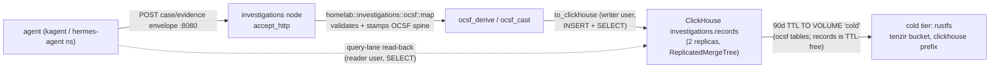
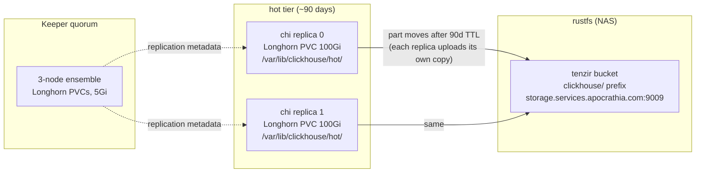

# ClickHouse datalake — the OCSF lake and investigations store

The custom resources behind the `ocsf` query store and the investigations
`records` table: the ClickHouseInstallation (CHI) `tenzir`, its Keeper
ensemble, the credentials renders, and the extracted server config. The
cluster is nested under the tenzir tree because its dedication is
structural — it exists to be this stack's datalake, and nothing else
writes here. The Altinity operator itself stays at the services root
([`03-services/clickhouse`](../../../../03-services/clickhouse/README.md));
this layer is its own Flux Kustomization (`services-clickhouse-cluster`)
gated on it.

> **Navigation**: [← Tenzir](../README.md) | [Investigations node](../nodes/investigations/README.md) | [Operator layer](../../../../03-services/clickhouse/README.md)

## Objects

| File                            | What it is                                                                                                                                          |
| ------------------------------- | --------------------------------------------------------------------------------------------------------------------------------------------------- |
| `secret.yaml`                   | OnePasswordItem renders in this namespace: `clickhouse-secrets` (user passwords) + `tenzir-secrets` (S3 cold-tier creds)                            |
| `keeper.yaml`                   | ClickHouseKeeperInstallation `tenzir` - 3-node Keeper ensemble                                                                                      |
| `cluster.yaml`                  | ClickHouseInstallation `tenzir` - thin CHI: users, keeper ref, cluster layout, pod template; `files:` holds placeholder keys stitched at build time |
| `config/00-storage-tiered.xml`  | Tiered-storage policy: hot Longhorn PVC + cold S3 disk (the stitched source of truth)                                                               |
| `config/10-startup-scripts.xml` | Schema bootstrap: investigations DDL first, then the ocsf tables (the stitched source of truth)                                                     |
| `flux-kustomization.yaml`       | Flux Kustomization `services-clickhouse-cluster` (this layer's gate)                                                                                |
| `kustomization.yaml`            | kustomize assembly: configMapGenerator + replacements stitch for the two config files                                                               |

The stitch is the authentik.tf / chaos-mesh build-time shape:
`kustomization.yaml` packages `config/` into a ConfigMap
(`tenzir-clickhouse-config`, `disableNameSuffixHash`), and replacements
rules byte-copy each key into the CHI's `spec.configuration.files`
entries. `config/` is the single source of truth — never edit the
placeholder keys in `cluster.yaml`, never render this directory outside
kustomize.

## Apply order

The operator chart installs the
`clickhouse.altinity.com` / `clickhouse-keeper.altinity.com` CRDs through
its pre-install hook job - CRs applied before that hook completes fail
with "no matches for kind". `services-clickhouse-cluster` applies only
after its gates clear:

- `services-clickhouse` - the Altinity operator itself (installs both CRDs).
- `bootstrap-1password` - OnePasswordItem CRD + operator (renders `secret.yaml`).
- `infrastructure-longhorn` - both CRs provision Longhorn PVCs.

This is the house pattern (services-tetragon-policies /
services-chaos-mesh-experiments / services-renovate-operator-config).

## The datalake shape: one JSON column

`investigations.records` is the single-JSON-column contract:

```sql
CREATE TABLE IF NOT EXISTS investigations.records
(
    `time` DateTime64(9, 'UTC') CODEC(Delta, ZSTD),
    `event` JSON COMMENT 'tenzir:catch_all' CODEC(ZSTD(3))
)
ENGINE = ReplicatedMergeTree('/clickhouse/{installation}/{cluster}/tables/{shard}/investigations/records', '{replica}')
PARTITION BY toYYYYMM(time)
ORDER BY (time)
SETTINGS storage_policy = 'tiered', ttl_only_drop_parts = 1
```

One typed column — `time`, the partition/sort spine — and one
[`tenzir:catch_all`](https://tenzir.com/integrations/clickhouse#catch-all-columns)
JSON column that absorbs the entire OCSF record. Nothing else is typed.
The vendor's own decision rule governs when to promote a typed column:

> "Choose typed columns for fields you filter, sort, or aggregate. Keep
> the rest in the catch-all until you need a dedicated column."
> — [Tenzir ClickHouse integration](https://tenzir.com/integrations/clickhouse),
> [to_clickhouse reference](https://tenzir.com/docs/reference/operators/to_clickhouse)

The case plane currently filters, sorts, and aggregates on nothing
beyond time — so the shape types nothing beyond time. When a real query
lane needs `metadata.correlation_uid` (say) as a typed column, promote
it with an operator-led live `ALTER` in the same lap as the DDL edit
(the D3/D4 pairing gate below).

### Write path



The investigations README owns the envelope contract and the lane
containment ([nodes/investigations](../nodes/investigations/README.md)).

## The typed-column trap (the failure class the shape kills)

The shape is not minimalism for its own sake — it is the direct product
of the 2026-10-18 boot-abort incident
([docs/issues/ocsf-clickhouse-ddl-convergence-and-broken-parts.md](../../../../../../docs/issues/ocsf-clickhouse-ddl-convergence-and-broken-parts.md)):

- `startup_scripts` executes sequentially and aborts at the FIRST
  failing query. Every typed column is a place where the DDL in git and
  the live table structure can diverge; when they do, the whole file
  aborts at boot and NOTHING gets created — including
  `investigations.records`.
- The ocsf tables hit exactly that: `class_uid` was retyped twice
  (UInt32 → Int32 across the corpus), a `severity_id` Int8 align touched
  nine CREATEs at once, and the LowCardinality/Nullable wrappings each
  needed their own live `ALTER` convergence. Each DDL edit without the
  paired live `ALTER` was a boot-abort in waiting.

A table whose only typed column is `time` cannot diverge: envelope
evolution and OCSF schema churn land inside the JSON where ClickHouse's
JSON type absorbs them without DDL. The ocsf tables keep their tuned
hand-DDL (they pay the convergence tax for dashboard hot paths); their
DDL/live convergence story is tracked in the issue above.

## Storage layout



- **Bucket layout**: cold parts write to the `tenzir` rustfs bucket under
  the `clickhouse/` prefix
  (`http://storage.services.apocrathia.com:9009/tenzir/clickhouse/`) —
  the ClickHouse data lake lives in the tenzir app's bucket, creds from
  the `tenzir-secrets` item (`aws-access-key-id` /
  `aws-secret-access-key`, rendered in this namespace by
  [`secret.yaml`](./secret.yaml); the same item the tenzir namespace
  renders — one item, multiple OnePasswordItem CRs). The old
  clickhouse-bucket-user keys on `clickhouse-secrets` are unused now;
  the operator removes them.
- **2x cold growth**: each replica runs the same tiered policy and
  uploads its own copy of every cold part — the bucket grows ~2x the
  single-node shape.
- **Retention** (ocsf tables): 90 days → `TO VOLUME 'cold'` (part
  moves), 400 days → `DELETE` (horizon cap, operator-tunable: change
  `INTERVAL 400 DAY` in `config/10-startup-scripts.xml` for new
  installs; `ALTER TABLE ... MODIFY TTL` server-side for live tables).
  `ttl_only_drop_parts = 1` keeps the delete a cheap partition drop.
  `investigations.records` has NO TTL by design — a case record is a
  durable audit record.
- **PVC-only metadata**: schema metadata (incl. S3 disk metadata under
  `/var/lib/clickhouse/disks/`) lives on the PVC only — losing BOTH
  PVCs orphans the S3 parts. Replication (2 copies) is the resilience
  mechanism; there is no kopiur/snapshot wiring on these PVCs by
  design.

## Schema bootstrap

`config/10-startup-scripts.xml` uses ClickHouse `startup_scripts` (the
Altinity-documented bootstrap mechanism; runs on every server start,
per replica, no `ON CLUSTER`): idempotent `CREATE DATABASE/TABLE IF NOT
EXISTS`, `ReplicatedMergeTree` with the operator-provided
`{installation}/{cluster}/{shard}/{replica}` macros. A replica with a
fresh PVC re-CREATEs and re-attaches to its Keeper replica path, then
re-syncs from its siblings.

- **Ordering is load-bearing**: investigations DDL runs FIRST so a
  failing ocsf CREATE cannot starve `investigations.records` of its
  bootstrap (the e29638e74 fix; see the ORDERING comment in the XML).
- **D3/D4 pairing gate**: init scripts never ALTER existing tables.
  Schema evolution is operator-led: a DDL edit ships its live `ALTER`s
  in the same lap, or the next boot aborts the whole file (the trap
  above).
- **Caveat**: `throw_on_error` stays false (reads survive Keeper
  outages), so a boot-time failure does not block the server — verify
  after any apply:

```bash
kubectl exec -n clickhouse chi-tenzir-ocsf-0-0-0 -- \
  clickhouse-client --query "SHOW TABLES FROM ocsf"
```

### Adding a class (ocsf tables only)

1. Add a `CREATE TABLE IF NOT EXISTS ocsf.<Class_Name>` block to
   `config/10-startup-scripts.xml` — never to `cluster.yaml`.
2. `kubectl exec` the `ALTER` on existing replicas if the class is not
   new (CREATE only runs on fresh data dirs otherwise).
3. Point the Tenzir pipeline at it (per-class table naming:
   `ocsf.{class_name.replace(" ", "_")}`).

`investigations.records` needs no class rows: it is the JSON catch-all
— envelope changes go through the investigations map operator, not DDL.

## Users (all in `cluster.yaml`, `spec.configuration.users`)

The operator renders these into `users.d` and injects the passwords as
env vars from the `clickhouse-secrets` Secret; git only ever names
fields:

| User                    | Password vault field                        | Grants                                  | Networks             |
| ----------------------- | ------------------------------------------- | --------------------------------------- | -------------------- |
| `tenzir`                | `clickhouse-password`                       | SELECT, INSERT on `ocsf.*`              | pod CIDR + localhost |
| `grafana`               | `clickhouse-grafana-password`               | SELECT on `ocsf.*`                      | pod CIDR + localhost |
| `investigations-writer` | `clickhouse-investigations-writer-password` | INSERT, SELECT on `investigations.*`    | pod CIDR + localhost |
| `investigations-reader` | `clickhouse-investigations-reader-password` | SELECT on `investigations.*` + `ocsf.*` | pod CIDR + localhost |

With a `grants` block present, access is exactly what is granted
(ClickHouse `<grants>` users.xml semantics); neither investigations
user can ALTER, TRUNCATE, or DROP — wipe is not a permitted operation on
this database. The `default` user stays network-restricted to the CHI's
own service FQDNs by the operator's `host_regexp` default.

## In-cluster endpoints

The operator creates the Services; name prefixes are fixed by its namer:

- `clickhouse-tenzir.clickhouse.svc.cluster.local` - CR-level service,
  load-balanced over both replicas. HTTP 8123 (Grafana datasource),
  native TCP 9000 (Tenzir `to_clickhouse`).
- `chi-tenzir-ocsf-<shard>-<replica>` services - per-host (e.g.
  `chi-tenzir-ocsf-0-0`); ad-hoc `clickhouse-client` targets when you
  need a specific replica.
- Keeper services (`chk-tenzir-ocsf-...`) - operator-internal; the CHI
  references the Keeper CR by name and the operator wires the
  endpoints.

## OCSF references

- Vendored schema docs in-tree: the
  [`tenzir-ocsf` skill](../.agents/skills/tenzir-ocsf/SKILL.md)
  (classes, objects, attributes, profiles; version pages under
  [`.agents/skills/tenzir-ocsf/v1.9.0/`](../.agents/skills/tenzir-ocsf/v1.9.0/)).
- Upstream schema explorer: [ocsf-schema.com](https://ocsf-schema.com)
  (the vendored docs' own reference for browsing classes and objects).
- Tenzir's OCSF normalization and lake guidance:
  [`tenzir` skill](../.agents/skills/tenzir/SKILL.md)
  ([map-to-ocsf](../.agents/skills/tenzir/guides/normalize/map-to-ocsf.md),
  [build-an-ocsf-lake-with-clickhouse](../.agents/skills/tenzir/tutorials/build-an-ocsf-lake-with-clickhouse.md)).

## Validation

```bash
kustomize build flux/manifests/03-services/clickhouse > /dev/null
kustomize build flux/manifests/04-apps/security/tenzir/clickhouse > /dev/null
helm repo add altinity https://helm.altinity.com
helm template altinity-operator altinity/altinity-clickhouse-operator \
  --version 0.27.4 -n clickhouse \
  -f <(yq '.spec.values' flux/manifests/03-services/clickhouse/operator.yaml)
```

Both CRs were validated against the exact CRD schemas shipped in
operator chart 0.27.4; the DDL + tiered-policy XML were executed
end-to-end on `clickhouse-server:25.8.33.6` with a Keeper (tables,
grants enforcement, dotted-column inserts, TTL move-to-cold, 400d
delete cap, restart idempotency — see the plan's evidence notes in
[`docs/plans/clickhouse-rollout.md`](../../../../../../docs/plans/clickhouse-rollout.md)).
