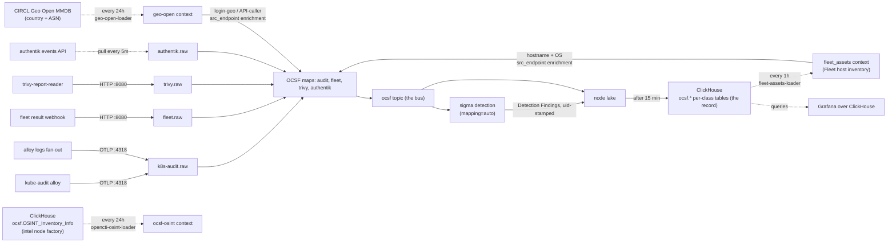

# Tenzir core node

> **Navigation**: [← Tenzir](../README.md) | [Tetragon node](../tetragon/README.md) | [Detections](../../detections/README.md) | [Upstream docs](https://tenzir.com/docs/)

The detection plane: one process (HelmRelease `tenzir-node-core`, rendering
pod `tenzir-node-core`) that normalizes every feed except the tetragon
flood and the netflow ingest to OCSF, publishes onto the unified
`ocsf` bus, and runs the one sigma pass. Fifteen pipelines live in
[`pipelines/`](./pipelines/), one `.tql` each, stitched back into
[`helmrelease.yaml`](./helmrelease.yaml) at kustomize build time; the
manifest stays the source of truth for tunables (sizes, limits,
retention values, ports). The NetFlow
collector moved to the dedicated
[netflow node](../netflow/README.md), and the `tenzir-ingest-lb`
LoadBalancer (pool IP `10.100.1.96`) moved with it — this node owns no
LB service anymore.

- k8s-audit-ingest-http / k8s-audit-ingest-grpc: OTLP listeners for the
  kube-audit alloy and the shared alloy OTLP log fan-out (the :4318
  listener carries both stream types)
- k8s-audit-ocsf, authentik-ocsf, fleet-ocsf, trivy-ocsf: per-source
  OCSF maps onto the bus; the audit and authentik arms enrich their
  src endpoints with geo country + ASN from the node-resident geo-open
  context plus Fleet hostname + OS from the node-resident fleet_assets
  context (fed by fleet-assets-loader) before the store/publish legs
  (the trivy arm also stamps its Detection Findings with the uid)
- sigma-detect: sigma over the bus with `mapping="auto"`, uid stamp,
  import into the lake
- http-ingest: fleet webhook and trivy-report-reader payloads
- authentik-pull: cron pull of the authentik events API
- geo-open-loader: the daily CIRCL Geo Open MMDB builder for the
  geo-open enrichment context (decoupled from the detection plane — a
  failed fetch never stalls the sigma pass)
- opencti-osint-loader: the intel factory's consumer half — reads the
  intel node's ocsf.OSINT_Inventory_Info ClickHouse table into
  the node-local ocsf-osint lookup-table context (the vendored
  `tenzir` library package's update_context, entries aging out after
  30d); in-stream consumption of the context stays with the category-4
  ingress nodes per the factory doctrine
- fleet-assets-loader: the hourly consumer half of the fleet_assets
  factory — pulls the enrichment node's ocsf.fleet_assets table from
  ClickHouse (FINAL, latest per Fleet host uuid) into this node's
  fleet_assets lookup-table context, keyed on primary_ip, so the
  audit and authentik arms above can stamp host identity onto
  src_endpoint (decoupled like the geo loader: a failed read never
  stalls the maps, and events pass unenriched until the first
  successful load)
- pipeline-metrics-to-mimir / sigma-metrics-to-mimir: the node's own
  operational metrics. The diagnostics-to-loki /
  error-diagnostics-to-mimir pair ships from this node again —
  restored per-node with the B1 lap after the central poller's
  retirement, so the poller-era double-ship concern is moot
- detection-attest-verify: the record_integrity verification walk —
  reads the last 24h of every ocsf class back from the ClickHouse
  query store, recomputes each attestation fingerprint, and walks the
  per-node prev_event chain; a Detection Finding (2004) drops per
  break, hourly (the `every` wrapper): the finding lands on the pod
  logs and INSERTs into `ocsf.Detection_Finding`, inside the Grafana
  tenzir-findings rule's WHERE clauses — tamper evidence pages through
  the agent_invoke bridge (landed;
  docs/issues/tenzir-record-integrity-attestations.md). The stamping
  half rides the ocsf-archive rule itself (see below).

## Connectivity



Enrichment scope is source-grounded: the kube-audit map always sets
`src_endpoint.ip` from `sourceIPs[0]` (a clean, always-present
source-IP field, grounded in the audit fixtures), so API Activity
gains geo country + ASN on the API caller unconditionally — the
dominant cluster-internal callers stay bare through the Geo Open
not-routed markers, and only external API callers geolocate. The
authentik map sets `src_endpoint.ip` from `client_ip` on every IAM
arm, so Authentication (login geo) and Account Change (mutation
origin) both enrich, while the Base Event arm passes through the
fork_merge complementary-where gate untouched (a null-key
context_enrich still writes its into-field, so the mixed-class
stream cannot run the operators unconditionally). The same arms also
look up the src endpoint IP in the fleet_assets context (keyed on
Fleet's primary_ip) and stamp `src_endpoint.hostname` +
`src_endpoint.os.name` in the vendored tenzir-ocsf Network Endpoint
shape — the audit and authentik src IPs are mostly cluster-internal
and miss, but a homelab login from a Fleet-managed LAN host gains
its inventory identity (fleet_assets rows without a primary_ip cannot
join and are skipped by the loader). No dns_lookup on
either: pod/service PTRs are NXDOMAIN noise, LAN clients have no
homelab PTRs, and attacker PTRs are absent or ISP-generic — the geo
ASN name already carries the provider. Private addresses stay bare.

The chart is this node's whole world: feeders, the bus, sigma, the lake,
the ClickHouse archive, and the Grafana query plane. Grafana owns
alerting off the archive; there is no other findings egress.

## Sizing

The upstream size-a-node formula, with this node's inputs. Limits that
follow from it live in [`helmrelease.yaml`](./helmrelease.yaml); inputs
marked assumed wait for post-recovery re-measurement.

```python
CPU = max(2, ceil(
    1 / 250        # ingest ~1 GB/day raw (assumed)
    + 4 * 0.1      # 4 sources: audit OTLP, authentik API, fleet, trivy (docs: 0.1 per source)
    + 1 * 0.1      # 1 destination: ClickHouse (docs: 0.1 per destination)
    + 4 * 0.2      # normalization on: OCSF maps on audit, authentik, fleet, trivy (docs: 0.2 per source)
    + 1            # detection on: sigma over the bus (docs: +1)
)) = max(2, ceil(2.304)) = 3 cores
```

```python
Storage = 1 * 30 * (1/2880) / 10 / 1000  # ingest GB/day * days/mo * months (15 min = 1/2880 mo) / Zstd 10x / GB to TB
        = 0.000001 TB (~1 MB for the full 15-minute window)
```

```python
RAM = max(2,
    0.000001 * 2   # catalog term: 2 GB per TB retained (docs); ~0 at a 15-minute window
    + 5 * 0.1      # sources (4) + destination (1)
    + 0.1          # enrichment: the geo-open context holds the ~80 MiB Geo Open MMDB in memory
    + 1            # detection state (docs: +1)
) = max(2, 1.6) = 2 GB
```

The memory limit is 8Gi: the formula's 2 GB floor plus the boot
catalog load, which pulled 76k partition synopses into RAM and
OOMKilled the node at ~94% of load under the old 4Gi on every start
(the tetragon sibling: 4.7k synopses under 12Gi). The CPU limit
matches the formula. Re-measure both after recovery and adjust in the
manifest, not here. The :4318 listener counts
two stream types (kube-audit alloy plus the shared alloy fan-out); both
are low-volume and the formula's source term already carries them.

## Retention

15-minute local horizon; the ClickHouse OCSF store is the record. One
rule in [`helmrelease.yaml`](./helmrelease.yaml) — TQL in
[`pipelines/ocsf-archive.tql`](./pipelines/ocsf-archive.tql) — exports
every class it stores to the per-class `ocsf.<Class_Name>` tables on
the ClickHouse OCSF store and consumes the originals
(archive-then-expire; `preserve-input` stays off). The compaction pass
runs every 5 minutes, so the true window at pass boundaries is 15 to 20
minutes. The Longhorn volume sits out the daily-backup RecurringJob
([`storage.yaml`](./storage.yaml)): a daily chain of a 15-minute buffer
is redundant with the ClickHouse record. Filesystem trim and snapshot
hygiene still run on the volume.

`to_clickhouse` is the rule's sole, terminal sink (the `to_s3` tail and
its `fork` wrapper retired with the MR-5 teardown — a sink-only
pipeline keeps consume + export = archive-then-delete semantics):
`mode="append"` fails loudly if the DDL is
missing, and `max_batch_rows=65536` (default 1s `batch_timeout`) bounds
the insert buffers per table.

The lake is a transit buffer between ingest and the archive, not a query
surface: it is sized to hold one window at worst-case flood rate, and
ClickHouse is the queryable history. The retired
`s3://tenzir/ocsf/` parquet archive stays untouched in the rustfs bucket
as frozen history; deleting it is a separate operator call. The Base
Event
fallback for fleet rows and authentik's non-IAM arm archives with the
mappable classes (added 2026-10-17): without a time rule those
partitions accumulated locally instead.

Horizon math, same inputs as the sizing block:

```python
Core (assumed ~1 GB/day raw ingest):
  1 GB/day raw / 10                # Zstd ~10x reduction (docs default)
  ~ 100 MB/day on disk             # on-disk rate after the reduction above
  100 MB/day / 96                  # 15-minute horizon (96 windows per day)
  ~ 1 MB peak local footprint      # vs the 6 GiB disk budget: never binds
```

The disk-budget corridor (6 GiB high / 4 GiB low, both the
`tenzir.start` quota and the compaction space budgets) is the backstop
for archive-rule failure windows, not the front door; the time rule is
the front door. The old 18/16 corridor was sized for a 24-hour horizon
and left the eraser unreachable on a 20Gi PVC:

```python
  6 GiB high  = 30% of the 20Gi PVC  # single-digit, reachable, leaves the PVC itself as the second backstop
  4 GiB low   = the erase target     # a 2 GiB corridor so one eraser pass reclaims real space
  6 GiB headroom at the worst stall  # core grows ~100 MB/day: the corridor never binds in practice
```

Naming note: the entry rename (`default` -> `core`) orphans the live
`state-tenzir-node-default-0` PVC at rollout and the lake re-wipes
fresh; accepted, ClickHouse is the record, and
`persistence.existingClaim` can adopt the old PVC if the lost hot window
ever matters.

## Adding a node

1. **Folder**: create `tenzir/nodes/<role>/` with `kustomization.yaml`,
   `helmrelease.yaml`, `README.md`.
2. **Token**: provision a node in the app.tenzir.com workspace and add
   its `tnz_...` token as a field on the `tenzir-secrets` 1Password
   item, labeled `<role>-node-token` (same convention as `core-node-token` /
   `tetragon-node-token`). The hosted platform issues per-node tokens only;
   workspace tokens are Sovereign-only.
3. **HelmRelease**: `metadata.name: tenzir-node-<role>`, chart
   `tenzir-node` from the `tenzir` HelmRepository, image pinned with the
   renovate comment, `nodes[0].name: <role>` (the entry name is the node
   name; every release takes `fullnameOverride: tenzir-node`),
   `nodes[0].token.existingSecret: tenzir-secrets` plus
   `nodes[0].token.key: <role>-node-token`, `extraPorts` for the node's
   listeners, `persistence.size` per sizing.
4. **Size it** with the size-a-node formula using measured ingest;
   requests small, limits justified.
5. **Retention**: disk budgets on its PVC plus `plugins.compaction`
   (weighted-age space rules as the backstop, one `to_clickhouse`
   archive rule for every class it stores).
6. **Catalog knobs**: the `tenzir.index` block from this node's
   [`helmrelease.yaml`](./helmrelease.yaml) (lazy-sketches, load
   concurrency 4).
7. **Archive**: the node writes into the shared ClickHouse OCSF
   tables; no per-node prefix.
8. **Content**: if the node mounts package or sigma files, add the
   `configMapGenerator` entries at the root kustomization (files stay in
   the shared `packages/` tree) plus subPath `extraVolumeMounts` in the
   node's HelmRelease.
9. **Feeder wiring**: point feeders at
   `tenzir-node-<role>.tenzir.svc.cluster.local:<port>`;
   the chart auto-generates the Service.
10. **Root kustomization**: add `- nodes/<role>` to `resources:`.
11. **README**: sizing math, retention profile, and this recipe.

## Troubleshooting

```sh
kubectl exec -n tenzir tenzir-node-core-0 -- \
  tenzir -e localhost:5158 \
  'metrics "pipeline" | summarize ingress_events=sum(ingress.events), pipeline_id'
kubectl logs -n tenzir tenzir-node-core-0 | grep -i error
# recent stored events
kubectl exec -n tenzir tenzir-node-core-0 -- \
  tenzir -e localhost:5158 'export | head 5'
# enrichment state: geo-open should list configured: true
kubectl exec -n tenzir tenzir-node-core-0 -- \
  tenzir -e localhost:5158 'context_list'
# sanity lookup against the loaded MMDB (any public IP)
kubectl exec -n tenzir tenzir-node-core-0 -- \
  tenzir -e localhost:5158 'from {ip: 1.1.1.1} | context_enrich "geo-open", key=ip, into=geo'
```

Sigma skip warnings (one per rule revision) name the rules the bus
cannot resolve; expect them from the parked SigmaHQ corpus. The
`tenzir.metrics.sigma` events size the rule-evaluation load. Known
detection noise lives on the tetragon node; see its README.
