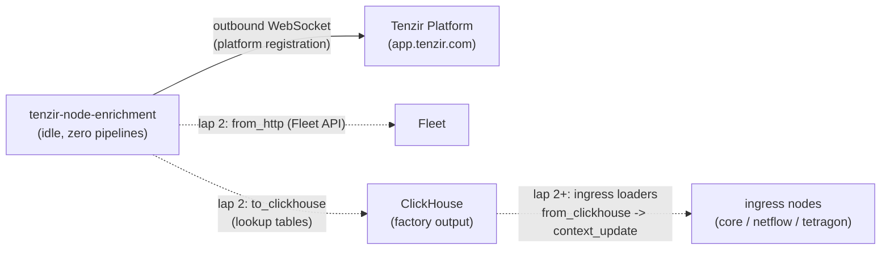

# Tenzir enrichment node

> **Navigation**: [← Tenzir](../README.md) | [Core node](../core/README.md) | [Investigations node](../investigations/README.md) | [Upstream docs](https://tenzir.com/docs/)

One process (HelmRelease `tenzir-node-enrichment`, rendering pod
`tenzir-node-enrichment`) reserved as the fleet's **context factory**:
the node whose pipelines build curated lookup tables — fleet assets,
threat intel, baselines — into the ClickHouse store, from where the
ingress nodes' loader pipelines pull them into their node-local
contexts. Lap 1 ships the empty factory: platform-registered, idle,
zero pipelines, no listeners. The factory content lands in
[`pipelines/`](./pipelines/README.md) from lap 2 on.

- **Pure puller, no ingest surface** — no `extraPorts`, no listener
  Service, no web server (and so no `certificate.yaml`): the chart
  renders only the main `tenzir-node-enrichment` Service on `:5158`
  for node RPC. All factory work is outbound (platform WebSocket now;
  Fleet API and ClickHouse writes from lap 2).
- **Deploys live** — this HelmRelease carries no `spec.suspend` and
  is the exception in the tree: the sibling nodes are currently
  suspended (cluster-side, out of band); the operator wants this node
  up while the factory is built.
- **Zero pipelines by design** — the `tenzir.pipelines` map is absent
  from the values, so the rendered config defines no pipelines and
  the node boots idle. Grounded: `helm template` against chart 0.1.0
  with no pipelines values renders a `tenzir.yaml` without the key,
  and the config schema starts exactly the pipelines defined under
  it — an absent map starts none. Lap 2 adds the key together with
  the first factory pipeline; no placeholder pipeline is shipped.

## Roadmap

1. **Lap 2 — `fleet_assets` factory pipeline**: pull host inventory
   from the Fleet REST API, fuse it into a stable asset table, and
   write it to ClickHouse. The ingress nodes then run the consumer
   half: `from_clickhouse` loaders feeding `context_update` into
   their node-local lookup-table contexts. This node gains the
   ClickHouse writer env wiring then (`TENZIR_SECRETS__CLICKHOUSE_
PASSWORD` from `clickhouse-secrets`, same shape as netflow) — lap
   1 wires no secret it does not use.
2. **Threat intel — abuse.ch ThreatFox** IOC feed as a second factory
   pipeline into its own ClickHouse table plus ingress loaders.
3. **Baselines** once the post-6.20 GA baseline capability lands.

**Scope exclusions** (stable design decisions, not lap gaps):

- No event-flow enrichment lives here. Enrichment of live events stays
  in-stream at the ingress nodes; this node only builds the reference
  data those in-stream steps read.
- The Geo Open MMDB stays per-node (each ingress node's geoip context
  loads its own copy; see netflow's `geo-open-loader`).
- Contexts remain per-node until cross-node contexts land (upstream
  target Q1 2027); until then the enrichment node produces the
  _source material_ in ClickHouse, and each node's loader owns its
  context state.

## Connectivity



Dashed lanes are the lap-2+ shape; lap 1 is the registration leg alone.

## Lake and storage

The chart's StatefulSet `volumeClaimTemplate` provisions the node lake
as the `state-tenzir-node-enrichment-0` PVC (Longhorn via the cluster
default storage class) — the chart's own mechanism, same as every
sibling. Lap 1 mirrors the investigations approach for an idle node:
`persistence.size: 5Gi`, no `storage.yaml`. The investigations
precedent covers this exact case — the node imports nothing yet, the
lake stays empty, and the PVC carries node state only. Netflow and
tetragon ship a `storage.yaml` for the Longhorn recurring-job
exclusion because their lakes are archived transit buffers; when the
lap-2 factory pipelines start writing real content, revisit whether
this PVC wants the same exclusion (a one-file add, and its spec must
mirror the `persistence` values exactly).

## Sizing

The upstream size-a-node formula at lap-1 volume (zero sources,
destinations, normalization): the `max(2, ·)` floor pins 2 cores and
the 2 GB RAM floor; requests small, limits justified in
[`helmrelease.yaml`](./helmrelease.yaml). Lap 2 re-sizes when the
factory pipelines land.

## Bootstrap

Already done by the operator: the node is registered in the
app.tenzir.com workspace and its `tnz_...` token copied into the
`enrichment-node-token` field of the `tenzir-secrets` 1Password item
(`../secret.yaml` materializes the Secret in this namespace). There is
nothing else to provision — no API token to generate (no web server),
no ClickHouse user needed until lap 2. The node comes up on apply.

## Troubleshooting

```sh
kubectl exec -n tenzir tenzir-node-enrichment-0 -- \
  tenzir -e localhost:5158 'metrics "pipeline"'
kubectl logs -n tenzir tenzir-node-enrichment-0 | grep -i error
kubectl get helmrelease -n tenzir tenzir-node-enrichment
```
