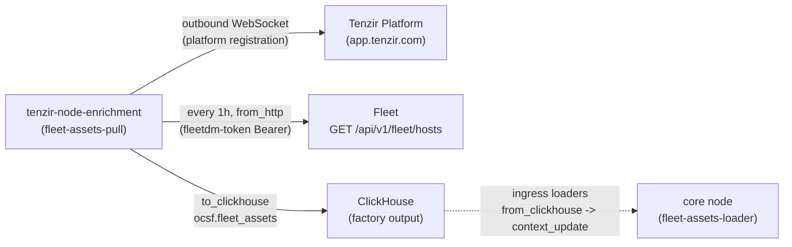

# Tenzir enrichment node

> **Navigation**: [← Tenzir](../README.md) | [Core node](../core/README.md) | [Investigations node](../investigations/README.md) | [Intel node](../intel/README.md) | [Upstream docs](https://tenzir.com/docs/)

One process (HelmRelease `tenzir-node-enrichment`, rendering pod
`tenzir-node-enrichment`) reserved as the fleet's **internal-reference-data
factory**: the node whose pipelines build curated lookup tables — fleet
assets, baselines — into the ClickHouse store, from where the
ingress nodes' loader pipelines pull them into their node-local
contexts. External threat intel is NOT this node's plane: the CTI
factory lives on the [intel node](../intel/README.md) (operator
choice (c)). Lap 2 shipped the first factory lane:
[`fleet-assets-pull`](./pipelines/fleet-assets-pull.tql), the hourly
Fleet host-inventory pull into `ocsf.fleet_assets` (the core node's
[`fleet-assets-loader`](../core/pipelines/fleet-assets-loader.tql) is
the consumer half). One pipeline, zero listeners, no lake writes —
ClickHouse is the only sink.

- **Pure puller, no ingest surface** — no `extraPorts`, no listener
  Service, no web server (and so no `certificate.yaml`): the chart
  renders only the main `tenzir-node-enrichment` Service on `:5158`
  for node RPC. All factory work is outbound (platform WebSocket,
  the Fleet API pull, and the ClickHouse write).
- **Deploys live** — this HelmRelease carries no `spec.suspend` and
  is the exception in the tree: the sibling nodes are currently
  suspended (cluster-side, out of band); the operator wants this node
  up while the factory is built.
- **Single-writer store convention** — `fleet-assets-pull` is the only
  INSERT lane into `ocsf.fleet_assets`; consumer nodes (core) only
  SELECT it. Both connect as the shared `tenzir` ClickHouse user
  (grants: `INSERT, SELECT ON ocsf.*`), so the single-writer rule is
  documentation, not RBAC — a second writer pipeline on any node
  would need this README and its own review.

## Roadmap

1. **Lap 2 — `fleet_assets` factory lane (SHIPPED)**: the hourly
   [`fleet-assets-pull`](./pipelines/fleet-assets-pull.tql) pulls host
   inventory from the Fleet REST API (`GET /api/v1/fleet/hosts`,
   full list — Fleet's ListOptions treat an unset `per_page` as
   unlimited) and writes the fused asset rows to `ocsf.fleet_assets`
   in the ClickHouse query store (ReplicatedReplacingMergeTree keyed
   on the Fleet host uuid, DDL in
   `../../clickhouse/config/10-startup-scripts.xml`).
   The core node runs the consumer half: its `fleet-assets-loader`
   fills the node-local `fleet_assets` lookup-table context from the
   table, and the authentik and k8s-audit maps stamp
   `src_endpoint.hostname` + `src_endpoint.os` from it. The
   ClickHouse writer env wiring (`TENZIR_SECRETS__CLICKHOUSE_PASSWORD`
   from `clickhouse-secrets`, same shape as netflow) and the Fleet
   bearer token (`TENZIR_SECRETS__FLEETDM_TOKEN` from `tenzir-secrets`,
   the operator-staged `fleetdm-token` field) ride this node now.
2. **Baselines** once the post-6.20 GA baseline capability lands.

**Scope exclusions** (stable design decisions, not lap gaps):

- No event-flow enrichment lives here. Enrichment of live events stays
  in-stream at the ingress nodes; this node only builds the reference
  data those in-stream steps read.
- No threat intel lives here. External CTI feeds are the intel node's
  plane; the two factory nodes share only the pattern (pull, land in
  ClickHouse, loader pulls back), not content.
- The Geo Open MMDB stays per-node (each ingress node's geoip context
  loads its own copy; see netflow's `geo-open-loader`).
- Contexts remain per-node until cross-node contexts land (upstream
  target Q1 2027); until then the enrichment node produces the
  _source material_ in ClickHouse, and each node's loader owns its
  context state.

## Connectivity



The solid lanes are live (lap 2): the hourly Fleet pull appends every
host's fused asset row into the ClickHouse table. The dashed loader
lane runs on the consumer node, not here — contexts are per-node, so
the ingress nodes pull their own copies (core ships its loader as
part of this lap; netflow/tetragon follow when their sources want
host identity).

## Lake and storage

The chart's StatefulSet `volumeClaimTemplate` provisions the node lake
as the `state-tenzir-node-enrichment-0` PVC (Longhorn via the cluster
default storage class) — the chart's own mechanism, same as every
sibling. Lap 1 sized it like the investigations node for an idle node:
`persistence.size: 5Gi`, no `storage.yaml`. That sizing still holds
after lap 2 — the factory pipeline's only sink is ClickHouse, nothing
imports into the lake, so the PVC still carries node state only and
the Longhorn recurring-job exclusion (netflow/tetragon's
`storage.yaml`) stays unneeded: there is no archived transit buffer
to protect here.

## Sizing

The upstream size-a-node formula re-run with the lap-2 factory shape:
one hourly batch source (the Fleet `from_http` pull of a 5-host
inventory) and one ClickHouse destination is far below the
`max(2, ·)` floor, so 2 cores / 2 Gi stand unchanged; requests stay
small, limits justified in [`helmrelease.yaml`](./helmrelease.yaml).

## Bootstrap

Done by the operator: the node is registered in the app.tenzir.com
workspace and its `tnz_...` token copied into the `enrichment-node-token`
field of the `tenzir-secrets` 1Password item (`../secret.yaml`
materializes the Secret in this namespace); the ClickHouse `tenzir`
writer user already exists (the archive legs' user, grants
`INSERT, SELECT ON ocsf.*`). One lap-2 action item remains on the
operator: the FleetDM API token for the pull pipeline's Bearer
header must be staged as the **`fleetdm-token` field** on the same
`tenzir-secrets` item (mint an API-only Fleet user; the field did
not exist yet as of 2026-10-19, verified read-only via `op`). Until
the field lands, `fleet-assets-pull` fails its first request with an
auth error and `restart-on-error` retries — the node itself stays up,
and the consumer side just sees an empty `fleet_assets` context.
Everything else is in git; the node comes up on apply.

## Troubleshooting

```sh
kubectl exec -n tenzir tenzir-node-enrichment-0 -- \
  tenzir -e localhost:5158 'metrics "pipeline"'
kubectl logs -n tenzir tenzir-node-enrichment-0 | grep -i error
kubectl get helmrelease -n tenzir tenzir-node-enrichment
```
