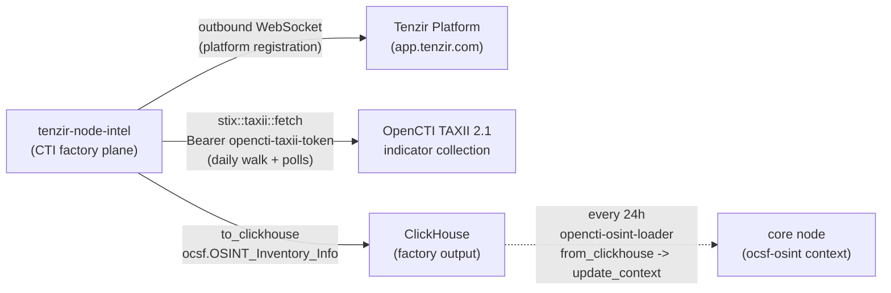

# Tenzir intel node

> **Navigation**: [← Tenzir](../README.md) | [Core node](../core/README.md) | [Enrichment node](../enrichment/README.md) | [Introspection node](../introspection/README.md) | [Upstream docs](https://tenzir.com/docs/)

One process (HelmRelease `tenzir-node-intel`, rendering pod
`tenzir-node-intel`) reserved as the fleet's **CTI factory plane** —
operator choice (c) of the intel-lane rounds: the factory row lives here
on the rc engine, not on the enrichment node. Its pipelines pull external
threat intel and land it in ClickHouse; the first row is live:
[opencti-taxii-factory](./pipelines/opencti-taxii-factory.tql) pulls
OpenCTI's TAXII 2.1 indicator collection (single pane: all CTI reaches
tenzir via OpenCTI), normalizes STIX Indicators to OCSF 5021 OSINT
Inventory Info, and appends them to the ClickHouse
`ocsf.OSINT_Inventory_Info` table, from where the core node's
[opencti-osint-loader](../core/pipelines/opencti-osint-loader.tql)
pulls the table into its node-local `ocsf-osint` context (the consumer
half). The [enrichment node](../enrichment/README.md) keeps the other
factory plane: internal reference data — fleet assets, baselines — not
threat intel.

- **Pure puller, no ingest surface** — no `extraPorts`, no listener
  Service, no web server (and so no `certificate.yaml`), no Gateway
  route: the chart renders only the main `tenzir-node-intel` Service
  on `:5158` for node RPC. All factory work is outbound: the platform
  WebSocket, the OpenCTI TAXII pull, and ClickHouse writes.
- **Runs the rc engine, alone** — image pinned to `v6.20.0-rc.3` while
  the fleet stays on `v6.19.1` GA: the vendored `stix` package's taxii
  fetch operator needs the 6.20 engine line. When 6.20 GA ships,
  renovate offers the bump (same datasource comment) and the pin
  rationale shrinks away; see
  [`helmrelease.yaml`](./helmrelease.yaml).
- **One factory row, dual-schedule** — `tenzir.pipelines` carries
  exactly the opencti-taxii-factory row: a daily full walk of the
  TAXII collection at 07:00 plus `added_after` polls at 01/13/19 (the
  upstream isMalicious dual-schedule doctrine), pulling through the
  vendored library `stix` package and appending OCSF OSINT Inventory
  Info rows to ClickHouse. The walk is the reconciliation path; the
  polls keep the table fresh between walks.
- **Deploys live** — this HelmRelease carries no `spec.suspend`: the
  factory row is this lap's deliverable and the rc pin only pays off
  running. (The fleet's storage-collector nodes are currently suspended
  cluster-side, out of band; the enrichment and introspection nodes
  share the no-suspend exception.)

## Connectivity



Outbound only: the node dials the platform, OpenCTI, and ClickHouse;
nothing dials in and no Gateway HTTPRoute exists for it. The dashed lane
is the consumer half on the core node — the table, not this node, is
the handoff.

## Lake and storage

The chart's StatefulSet `volumeClaimTemplate` provisions the node lake
as the `state-tenzir-node-intel-0` PVC (Longhorn via the cluster
default storage class). `persistence.size: 5Gi`, no `storage.yaml`:
the factory row streams its pulls straight to ClickHouse with no lake
import, so the lake carries node state only (the investigations and
enrichment precedent); there is no archive rule and no transit buffer
to protect. The factory's output is the ClickHouse table, not this
lake. If a future lane imports into the lake, revisit the Longhorn
recurring-job exclusion (netflow/tetragon ship a `storage.yaml` for
exactly that case, and its spec must mirror the `persistence` values).

## Sizing

The upstream size-a-node formula at the factory row's shape (one HTTP
source + one ClickHouse destination + STIX normalization, ~2k
indicators/day): the `max(2, ·)` floor pins 2 cores and the 2 GB RAM
floor; requests small, limits justified in
[`helmrelease.yaml`](./helmrelease.yaml). Re-measure when a second
factory lane lands or the collection grows past the MISP connector's
backlog
([misp-deployment.md](../../../../../../../docs/issues/misp-deployment.md)).

## Bootstrap

Already done by the operator: the node is registered in the
app.tenzir.com workspace and its `tnz_...` token copied into the
`intel-node-token` field of the `tenzir-secrets` 1Password item
([`../../secret.yaml`](../../secret.yaml) materializes the Secret in
this namespace; the OnePasswordItem CR is field-agnostic, so the new
key arrives with the operator's next item sync — no manifest change).
The factory row reads one more vault field, `opencti-taxii-token` —
the TAXII bearer token written by the opencti lane (the manifests may
land first; the pipeline retries via restart-on-error until the field
materializes). The ClickHouse writer is the shared existing `tenzir`
user; no new user needed. The node comes up on apply.

## Roadmap

1. ~~First factory row~~ — **done**: the OpenCTI TAXII row is live
   (this node) plus the core-node loader (the consumer half). The
   TAXII 2.1 export surface and collection are the opencti lane's
   slice-7 handoff
   ([opencti-deployment.md](../../../../../../../docs/issues/opencti-deployment.md));
   the collection's indicator volume climbs as the MISP connector
   import finishes.
2. **Threat intel — abuse.ch ThreatFox** IOC feed as a second intel
   source into its own ClickHouse table plus ingress loaders; the
   factory pattern is proven by the OpenCTI row.

## Troubleshooting

```sh
kubectl exec -n tenzir tenzir-node-intel-0 -- \
  tenzir -e localhost:5158 'metrics "pipeline"'
kubectl logs -n tenzir tenzir-node-intel-0 | grep -i error
kubectl get helmrelease -n tenzir tenzir-node-intel
```

A failed walk self-heals: `restart-on-error` retries every minute and
the next scheduled cron re-runs the lane regardless; the daily walk
reconciles anything the polls missed. First boot after the rc pin:
if the pod crash-loops, read `server.log` via the `tenzir-logs`
mount before anything else — the file logger is the diagnostics
surface the warning verbosity exists for.
