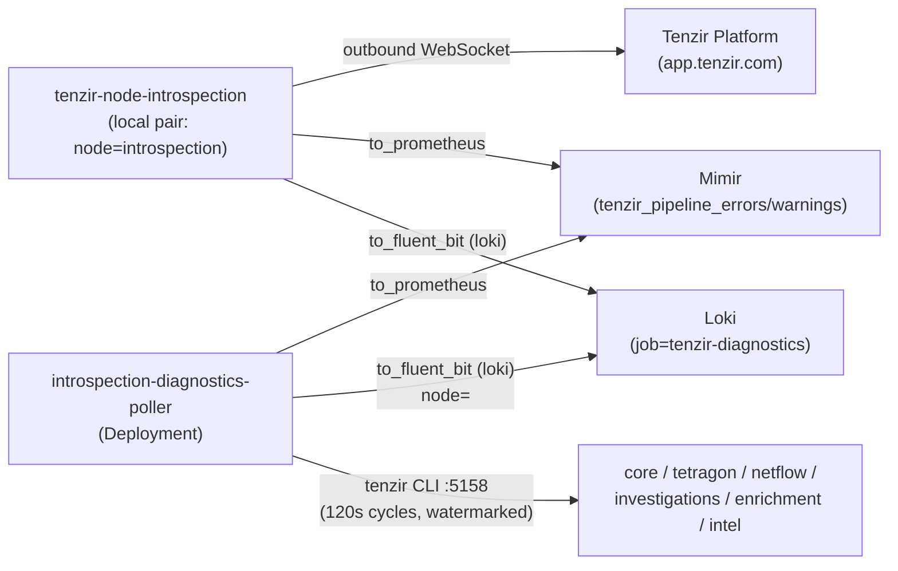

# Tenzir introspection node

> **Navigation**: [← Tenzir](../README.md) | [Core node](../core/README.md) | [Tetragon node](../tetragon/README.md) | [Netflow node](../netflow/README.md) | [Investigations node](../investigations/README.md) | [Enrichment node](../enrichment/README.md) | [Upstream docs](https://tenzir.com/docs/)

One process (HelmRelease `tenzir-node-introspection`, rendering pod
`tenzir-node-introspection`) reserved as the fleet's **diagnostics
observability plane**, plus the central poller Deployment that ships
every fleet node's pipeline diagnostics to Loki and Mimir. The
introspection half of the tenzir-diagnostics lap: the Grafana
`tenzir-node-pipelines` dashboard keeps working unchanged — same
`job=tenzir-diagnostics` labels, same `tenzir_pipeline_errors` /
`tenzir_pipeline_warnings` series — while the per-node "diagnostics to
loki" / "error diagnostics to mimir" lanes retire fleet-wide
(superseded): core/tetragon/netflow here, plus investigations' pair,
which MR !5354 added mid-flight and this MR retires the same way.

- **Local pair, sibling shape** —
  [`pipelines/diagnostics-to-loki.tql`](./pipelines/diagnostics-to-loki.tql)
  and
  [`pipelines/error-diagnostics-to-mimir.tql`](./pipelines/error-diagnostics-to-mimir.tql)
  cover this node's own two pipelines (`node=introspection`), so the
  poller's host node is not the one blind spot. Byte-identical to the
  retired sibling lanes modulo the node label.
- **Pure puller, no ingest surface** — no `extraPorts`, no listener
  Service, no web server (and so no `certificate.yaml`): the chart
  renders only the main `tenzir-node-introspection` Service on `:5158`
  for node RPC. All work is outbound (platform WebSocket, the poller's
  client dials).
- **The poller is NOT the node** —
  [`poller.yaml`](./poller.yaml) deploys `introspection-diagnostics-poller`,
  a sibling Deployment in this folder: v6.19.1 node-config TQL cannot
  pull a remote node's diagnostics (`remote{}` is a no-op location
  marker in the new executor, live-probed 2026-10-18), so the poller
  pod runs the `tenzir` CLI against each target's `:5158` and ships
  through the same `to_fluent_bit` / `to_prometheus` operators the
  native lanes used. Targets: core, tetragon, netflow, investigations,
  enrichment, intel — core/tetragon/netflow are the nodes whose lanes
  retired in this slice; investigations' mid-flight pair (MR !5354)
  retires here too; enrichment never had any, and intel (new in this
  MR) never had any either.

## Connectivity



## Poller semantics

Per-target wall-clock watermark, captured before each poll and kept
only on a successful poll: events ship exactly once across cycles, a
failed or timed-out target retries its window on the next cycle, and no
event-store parsing is needed. A down or not-yet-deployed target is a
logged warning per cycle, never a crash: the poller keeps cycling its
other targets. In-memory (draft-shipper parity): a
poller restart loses the in-flight window, and the first cycle after a
start ships nothing — no store-backlog replay, the same no-dedup trade
the native lanes made (Loki has no dedup; diagnostics retention on the
targets is 30d if a manual backfill is ever wanted). Blind spot
inherited from any `:5158` pull: console-only transformer failures
never land in the diagnostics store; `kubectl logs` on the node pod
stays the surface for those.

Hidden-diagnostics parity is per arm, matching each retired native lane
exactly: the Loki arm filters `where not hidden` (native
diagnostics-to-loki did), while the Mimir error/warning arms count
hidden entries too (native error-diagnostics-to-mimir had no hidden
filter — the dashboard's series always counted them). The split is
load-bearing: most warning volume is hidden (live 2026-10-18 store
reads: netflow 306 hidden vs 3 visible warnings; investigations 1104
hidden), so filtering the Mimir arms would change
`sum_over_time(tenzir_pipeline_warnings[6h])` materially versus the
native lanes.

## Lake and storage

The chart's StatefulSet `volumeClaimTemplate` provisions the node lake
as the `state-tenzir-node-introspection-0` PVC (Longhorn via the
cluster default storage class). Investigations/enrichment shape: the
node imports nothing, the lake stays empty, and the PVC carries node
state only — no `storage.yaml` recurring-job exclusion needed.

## Sizing

Upstream size-a-node formula at introspection volume (near zero): the
`max(2, ·)` floor pins 2 cores and the 2 GB RAM floor; requests small,
limits justified in [`helmrelease.yaml`](./helmrelease.yaml). The
poller pod is sized like a script runner (50m/128Mi requests), the CLI
spikes live inside the 500m/512Mi limits.

## Bootstrap

Already done by the operator: the node is registered in the
app.tenzir.com workspace (`t-vrj4igpf`) and its `tnz_...` token copied
into the `introspection-token` field of the `tenzir-secrets` 1Password
item (`../secret.yaml` materializes the Secret in this namespace; the
OnePasswordItem CR is field-agnostic, so the new key arrives with the
operator's next item sync — no manifest change). There is nothing else
to provision — no API token (no web server), no ClickHouse users, no
ingest feeders to point at it. The node and the poller come up on
apply.

## Troubleshooting

```sh
# poller cycle status (watermark windows + failures)
kubectl logs -n tenzir deployment/introspection-diagnostics-poller
# the node's own diagnostics (local pair covers node=introspection)
kubectl exec -n tenzir tenzir-node-introspection-0 -- \
  tenzir -e localhost:5158 'diagnostics | where not hidden | head 10'
# a target's store, split by hidden/severity the way the arms see it
kubectl exec -n tenzir tenzir-node-introspection-0 -- \
  tenzir -e tenzir-node-investigations.tenzir.svc:5158 \
  'diagnostics retro=true | summarize n=count(), hidden, severity'
kubectl get helmrelease -n tenzir tenzir-node-introspection
```
