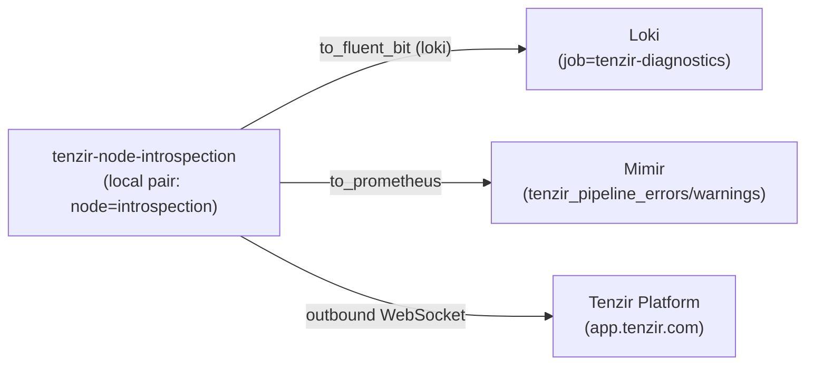

# Tenzir introspection node

> **Navigation**: [← Tenzir](../README.md) | [Core node](../core/README.md) | [Tetragon node](../tetragon/README.md) | [Netflow node](../netflow/README.md) | [Investigations node](../investigations/README.md) | [Enrichment node](../enrichment/README.md) | [Upstream docs](https://tenzir.com/docs/)

One process (HelmRelease `tenzir-node-introspection`, rendering pod
`tenzir-node-introspection`) reserved as the fleet's **introspection
plane**. Since the B1 lap every node ships its own pipeline
diagnostics to Loki and Mimir through its node-config lane pair —
the central poller Deployment that used to ride here is retired — and
this node's own pair covers its own two pipelines, byte-identical to
the siblings' pair modulo the node label. The Grafana
`tenzir-node-pipelines` dashboard keeps working unchanged: same
`job=tenzir-diagnostics` labels, same `tenzir_pipeline_errors` /
`tenzir_pipeline_warnings` series.

- **Local pair, sibling shape** —
  [`pipelines/diagnostics-to-loki.tql`](./pipelines/diagnostics-to-loki.tql)
  and
  [`pipelines/error-diagnostics-to-mimir.tql`](./pipelines/error-diagnostics-to-mimir.tql)
  cover this node's own pipelines (`node=introspection`).
- **Pure puller, no ingest surface** — no `extraPorts`, no listener
  Service, no web server (and so no `certificate.yaml`): the chart
  renders only the main `tenzir-node-introspection` Service on `:5158`
  for node RPC. All work is outbound (platform WebSocket, plus the
  two ship lanes dialing Loki and Mimir).
- **Charter direction: inward detection** — the stateless design's
  phase 3 (post-GA) gives this node scheduled
  `from_clickhouse` volume/freshness/baseline passes over the
  `ocsf.*` tables, landing operational Detection Findings. See
  [Charter](#charter-inward-detection) below.

## Connectivity



## Lane semantics

`live=true` without retro: the lanes ship only diagnostics emitted
while they run — no store-backlog replay on start, so restarts never
re-ship history (Loki has no dedup). The per-arm hidden split stays
load-bearing: the Loki arm filters `where not hidden` (platform-UI
pipeline deprecation noise stays out of the log lines), while the
Mimir error/warning arms count hidden entries too, because most
warning volume is hidden (live 2026-10-18 store reads: netflow 306
hidden vs 3 visible warnings; investigations 1104 hidden) — filtering
them would change
`sum_over_time(tenzir_pipeline_warnings[6h])` materially versus the
series the dashboard has always counted. Console-only transformer
failures never land in the diagnostics store; `kubectl logs` on the
node pod stays the surface for those.

## Charter: inward detection

The node's post-GA direction (design phase 3 of the CH-only
migration): scheduled `from_clickhouse` passes over the `ocsf.*`
tables — volume and freshness per class, baseline-abnormality once
the post-6.20-GA baseline capability lands — landing their findings
as `ocsf.Detection_Finding` rows:

- **Wiring first**: the node has no ClickHouse wiring today. The
  charter needs `from_clickhouse` reads (the shared `tenzir` user,
  `SELECT ocsf.*`) and `to_clickhouse` writes (`INSERT
ocsf.Detection_Finding`), the enrichment node's
  `TENZIR_SECRETS__CLICKHOUSE_PASSWORD` shape.
- **Severity discipline**: charter findings stay operational —
  below the Grafana tenzir-findings rule's `severity_id >= 4` page
  threshold. They are volume/freshness observations, not security
  findings; paging the investigator through the `agent_invoke`
  bridge is a deliberate exception, not the default.
- **Liveness plan**: the charter pipelines are the exact every/cron
  shape that has come up born-dead before (the investigations
  attest walker: completed-terminal, zero walks). Each scheduled
  pass gets `unstoppable: true` + `restart-on-error` (completion
  becomes failed becomes relaunch), server-side pass evidence via
  the ClickHouse `query_log` (never `pipeline_list`), and a
  freshness/absence alert on that pass evidence.
- **Timing**: unblocked by phase 0 (this B1 lap) and GA — the
  `ocsf.*` tables are populated today, so the charter's freshness
  passes can instrument the phase-2 write-path migration as it
  lands instead of trailing it. The baseline-abnormality component
  alone waits on the baseline capability (post-GA, no committed
  date; baselines ride the enrichment node's factory pattern —
  source material in ClickHouse, this node loads it into its own
  context).

## Lake and storage

The chart's StatefulSet `volumeClaimTemplate` provisions the node lake
as the `state-tenzir-node-introspection-0` PVC (Longhorn via the
cluster default storage class). Investigations/enrichment shape: the
node imports nothing, the lake stays empty, and the PVC carries node
state only — no `storage.yaml` recurring-job exclusion needed.

## Sizing

Upstream size-a-node formula at introspection volume (near zero): the
`max(2, ·)` floor pins 2 cores and the 2 GB RAM floor; requests small,
limits justified in [`helmrelease.yaml`](./helmrelease.yaml). The
charter's scheduled passes re-run the formula when they land.

## Bootstrap

Already done by the operator: the node is registered in the
app.tenzir.com workspace (`t-vrj4igpf`) and its `tnz_...` token copied
into the `introspection-node-token` field of the `tenzir-secrets` 1Password
item (`../secret.yaml` materializes the Secret in this namespace; the
OnePasswordItem CR is field-agnostic, so the new key arrives with the
operator's next item sync — no manifest change). There is nothing else
to provision — no API token (no web server), no ClickHouse users (the
charter's wiring lands with the charter), no ingest feeders to point
at it. The node comes up on apply.

## Troubleshooting

```sh
# the node's own diagnostics (the local pair ships these to Loki)
kubectl exec -n tenzir tenzir-node-introspection-0 --   tenzir -e localhost:5158 'diagnostics | where not hidden | head 10'
# the store split the way the arms see it: Loki arm filters hidden,
# Mimir arms count it
kubectl exec -n tenzir tenzir-node-introspection-0 --   tenzir -e localhost:5158   'diagnostics retro=true | summarize n=count(), hidden, severity'
kubectl get helmrelease -n tenzir tenzir-node-introspection
```

B1 lanes can come up born-dead on fresh rolls — validate first boot
server-side (diagnostics in Loki, `tenzir_pipeline_*` samples in
Mimir), not from `pipeline_list` states.
