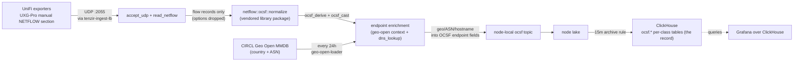

# Tenzir netflow node

> **Navigation**: [← Tenzir](../README.md) | [Core node](../core/README.md) | [Tetragon node](../tetragon/README.md) | [Upstream docs](https://tenzir.com/docs/)

One process (HelmRelease `tenzir-node-netflow`, rendering pod
`tenzir-node-netflow`) that owns the NetFlow collector and nothing else.
Four pipelines live in
[`pipelines/`](./pipelines/), one `.tql` each, stitched back into
[`helmrelease.yaml`](./helmrelease.yaml) at kustomize build time:
netflow-ingest (the UDP
listener + OCSF mapping + endpoint enrichment), geo-open-loader (the
daily GeoIP context builder for that enrichment),
pipeline-metrics-to-mimir (a dead UDP collector is a silent black
hole, so this node keeps the core node's liveness series), and
netflow-attest-verify (the hourly record_integrity walk — the
verification half of the attestation lane below). The former
diagnostics pushers (error-diagnostics-to-mimir, diagnostics-to-loki)
retired with the introspection lap: the central poller on the
introspection node ships this node's diagnostics to Loki and Mimir
now. The split exists so the
collector's lifecycle (listener restarts, pod rolls, future
vendor-traffic surprises) cannot touch the detection plane, and so
flow ingest has room to grow when the UniFi renderer fix lands; the
loader is equally decoupled — a slow or failed MMDB fetch never
stalls flow ingest (the context keeps serving the last good
database).

The collector moved here from the core node (2026-10-17); the
`tenzir-ingest-lb` LoadBalancer moved with it
([`service-ingest.yaml`](./service-ingest.yaml)) — same name, same
pool IP `10.100.1.96`, same alloy pairing, only the selector points at
this pod.

## Connectivity



Flow records publish onto this node's own `ocsf` topic and feed this
node's own archive rule, tetragon-style node-local: nothing about the
flow stream rides the core detection node's bus. No sigma pass runs
here — no homelab sigma rule targets netflow fields (the homelab rules
are k8s-audit only), so the move loses no detection coverage; netflow
events reach the archive and Grafana, not the sigma pass. The vendored
package that does the mapping:
[`packages/netflow/`](../../packages/netflow/README.md).

## Sizing

The upstream size-a-node formula with this node's inputs. Limits live in
[`helmrelease.yaml`](./helmrelease.yaml).

```python
CPU = max(2, ceil(
    0.15 / 250     # netflow ingest ~0.15 GB/day raw (measured; core README sizing input)
    + 1 * 0.1      # 1 source: the UniFi exporters via the LB (docs: 0.1 per source)
    + 1 * 0.1      # 1 destination: ClickHouse (docs: 0.1 per destination)
    + 1 * 0.2      # normalization on: the netflow OCSF map (docs: 0.2 per source)
    + 0            # detection off
)) = max(2, ceil(0.40)) = 2 cores
```

```python
Storage = 0.15 * 30 * (1/2880) / 10 / 1000  # netflow GB/day * days/mo * months (15 min = 1/2880 mo) / Zstd 10x / GB to TB
        = 0.00000016 TB (~150 KB for the full 15-minute window)
```

```python
RAM = max(2,
    0.00000016 * 2  # catalog term: 2 GB per TB retained (docs); ~0 at a 15-minute window
    + 2 * 0.1       # sources (1) + destination (1)
    + 0.1           # enrichment: the geo-open context holds the ~80 MiB Geo Open MMDB in memory
    + 0             # no detection
) = 2 GB
```

The limits (2 cores, 4Gi) stay close to the formula on purpose: the
formula's 2-core floor binds, and 4Gi is its 2 GB RAM floor with 2x
headroom. Neither sibling's overshoot driver applies — core's 8Gi comes
from a 76k-synopsis boot history, tetragon's 12Gi from the flood
working set; a fresh tiny lake carries neither. The node is sized for
today's probe-only traffic with room for the exporter fix
([issue](../../../../../../../docs/issues/unifi-uxg-ipfix-ck-plus-hosting.md)).

## Retention

Same 15-minute horizon as the siblings, same archive: the one OCSF
class this node stores (Network Activity 4001) exports to the
per-class `ocsf.<Class_Name>` tables on the ClickHouse OCSF store at
`after: 15 minutes` and then expires locally (archive-then-expire;
`preserve-input` off). The lake is a transit buffer between ingest and
the archive, not a query surface. ClickHouse is the OCSF record past
the window; the compaction pass runs every 5 minutes, so the true
window at pass boundaries is 15-20 minutes. The Longhorn volume sits
out the daily-backup RecurringJob
([`storage.yaml`](./storage.yaml)): a daily chain of a 15-minute
buffer is redundant with the ClickHouse record. Filesystem trim and
snapshot hygiene still run on the volume. The retired
`s3://tenzir/ocsf/` parquet archive stays untouched in the rustfs
bucket as frozen history; deleting it is a separate operator call.

`to_clickhouse` is the rule's sole, terminal sink (the `to_s3` tail and
its `fork` wrapper retired with the MR-5 teardown — a sink-only
pipeline keeps consume + export = archive-then-delete semantics):
`mode="append"` fails loudly if the DDL is missing, and
`max_batch_rows` bounds the insert buffers.

The archive rule also stamps the OCSF `record_integrity` attestation
on every record BEFORE the INSERT ([`pipelines/ocsf-archive.tql`](./pipelines/ocsf-archive.tql), the shared lane in
[`packages/homelab/operators/record_integrity/`](../../packages/homelab/operators/record_integrity/README.md)):
a per-node SHA-256 fingerprint chain (`chain_uid` =
`tenzir-node-netflow`), one chain across the one archived class in
(time, uid) order, covering the record exactly as stored — and the
(time, uid) tie-break is load-bearing here: v5 exporters stamp whole
datagrams of flows with one timestamp, so same-time ties are the
NORM on this lane. `netflow-attest-verify` walks it hourly: the last
24h of `ocsf.Network_Activity` read back, fingerprints recomputed,
chain links checked; a Detection Finding (2004, severity 4) drops per
break onto the pod logs AND into `ocsf.Detection_Finding`, inside the
Grafana tenzir-findings rule's WHERE clauses — tamper evidence pages
through the agent_invoke bridge like every other high-severity finding
(docs/issues/tenzir-record-integrity-attestations.md). The shared
table note: the tetragon node's archive rule writes its Network
Activity rows into the same `ocsf.Network_Activity` table — its
cross-class chain is walked by the tetragon lane; this lane reads and
walks only THIS node's chain (the `chain_uid` filter in the verify
pipeline) so a healthy cross-class tetragon record never trips the
table-local predecessor walk. At today's
probe-only flow volume the stamping cost is noise (the detection-plane
numbers in the clickhouse README's attestation section); the netflow
baselines in the homelab package tests pin the chain, the tie-break,
and both break types.

Horizon math:

```python
Netflow (measured 0.15 GB/day raw):
  0.15 GB/day / 10                # Zstd ~10x reduction (docs default)
  ~ 15 MB/day on disk             # on-disk rate after the reduction
  15 MB/day / 96                  # 15-minute horizon (96 windows per day)
  ~ 150 KB peak local footprint   # vs the 6 GiB disk budget: never binds
```

The disk-budget corridor (6 GiB high / 4 GiB low) is the backstop for
archive-rule failure windows on the 20Gi PVC; the time rule is the
front door, and both overprovisioned on purpose — Longhorn grows the
volume on demand and a smaller request buys nothing.

## Collector quirks

- **Template-datagram ordering**: v9/IPFIX flows are undecodable
  without their template datagrams, and the UXG exporter's manual
  NETFLOW section re-sends templates on `refreshRate: 20` — a collector
  that boots after them drops undecodable data for up to 20 minutes.
  UDP is fire-and-forget; while the LB has no Ready endpoints,
  datagrams vanish. Rollout order: bring this node up and verify flow
  ingress before retiring the collector on the core node.
- **Probe-only today**: the UXG exporter only emits via the manual
  NETFLOW section workaround (any controller config push kills it;
  vendor renderer bug, the issue stays open). The node exists to
  isolate the collector and to have room when the fix lands.
- **Name disambiguation**: the platform node name `netflow` (this
  HelmRelease's entry, rendering `tenzir-node-netflow`) and the vendored
  TQL package id `netflow` (`netflow::ocsf::normalize`) are unrelated
  namespaces — one names this node in the hosted workspace, the other
  the package the pipeline calls. Do not conflate them.

## Adding a node

1. **Folder**: create `tenzir/nodes/<role>/` with `kustomization.yaml`,
   `helmrelease.yaml`, `README.md`.
2. **Token**: provision a node in the app.tenzir.com workspace and add
   its `tnz_...` token as a field on the `tenzir-secrets` 1Password
   item, labeled `<role>-node-token` (same convention as `netflow-node-token` /
   `tetragon-node-token` / `core-node-token`). The hosted platform issues
   per-node tokens only; workspace tokens are Sovereign-only.
3. **HelmRelease**: `metadata.name: tenzir-node-<role>`, chart
   `tenzir-node` from the `tenzir` HelmRepository, image pinned with the
   renovate comment, `nodes[0].name: <role>`: the entry name is the node
   name, because the chart renders every node resource as
   `<fullname>-<entry.name>`; every release takes
   `fullnameOverride: tenzir-node` (fullname otherwise defaults to the
   release name, which doubles the role when the release contains
   `tenzir-node` and prepends the chart name when it does not, never
   rename a release into either concat trap),
   `nodes[0].token.existingSecret: tenzir-secrets` plus
   `nodes[0].token.key: <role>-node-token`, `extraPorts` for the node's
   listeners, `persistence.size` per sizing.
4. **Size it** with the size-a-node formula using measured ingest;
   requests small, limits justified.
5. **Retention**: disk budgets on its PVC plus `plugins.compaction`
   (weighted-age space rules as the backstop, archive-then-expire time
   rules for every record type it stores), and a `storage.yaml` label
   overlay sitting the transit-lake PVC out of the daily-backup
   RecurringJob (same shape as the core, netflow, and tetragon nodes).
6. **Catalog knobs**: the `tenzir.index` block from
   [`helmrelease.yaml`](./helmrelease.yaml) (lazy-sketches, load
   concurrency 4).
7. **Archive**: `to_clickhouse` into the per-class `ocsf.<Class_Name>`
   tables on the ClickHouse OCSF store — same terminal sink, same
   `mode="append"` + `max_batch_rows` shape as every sibling. Detections
   run on the core node only; this node owns its feeds and its lake.
8. **Content**: if the node mounts package or sigma files, add the
   `configMapGenerator` entries at the root kustomization (files stay in
   the shared `packages/` tree) plus subPath `extraVolumeMounts` in the
   node's HelmRelease.
9. **Feeder wiring**: point feeders at
   `tenzir-node-<role>.tenzir.svc.cluster.local:<port>`;
   the chart auto-generates the Service.
10. **Root kustomization**: add `- nodes/<role>` to `resources:`.
11. **README**: sizing math, retention profile, and this recipe.

## Troubleshooting

```sh
kubectl exec -n tenzir tenzir-node-netflow-0 -- \
  tenzir -e localhost:5158 \
  'metrics "pipeline" | summarize ingress_events=sum(ingress.events), pipeline_id'
kubectl logs -n tenzir tenzir-node-netflow-0 | grep -i error
# recent stored events
kubectl exec -n tenzir tenzir-node-netflow-0 -- \
  tenzir -e localhost:5158 'export | head 5'
# enrichment state: geo-open should list configured: true
kubectl exec -n tenzir tenzir-node-netflow-0 -- \
  tenzir -e localhost:5158 'context_list'
# sanity lookup against the loaded MMDB (any public IP)
kubectl exec -n tenzir tenzir-node-netflow-0 -- \
  tenzir -e localhost:5158 'from {ip: 1.1.1.1} | context_enrich "geo-open", key=ip, into=geo'
```

The Node Pipelines dashboard (Grafana) is this node's liveness view:
the heartbeat panel reads the `tenzir_pipeline_*` series this node's
metrics pipelines push; the `pipeline_id` label is the bare pipeline id,
so the `node` label stamped by every pipeline-metrics arm is what
separates same-id exporters across nodes — split on `node`
(`netflow` here) when the
`{{pipeline_name}}` legend shows multiple nodes' self-reports under one
name. If the exporter went quiet, check the UXG's manual NETFLOW
section first — a controller config push kills it
([runbook](../../../../../../../docs/issues/unifi-uxg-ipfix-ck-plus-hosting.md)).
