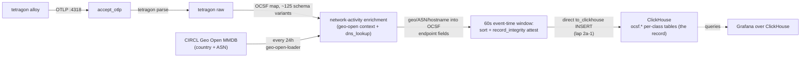

# Tenzir tetragon node

> **Navigation**: [← Tenzir](../README.md) | [Core node](../core/README.md) | [Upstream docs](https://tenzir.com/docs/)

One process (HelmRelease `tenzir-node-tetragon`, rendering pod
`tenzir-node-tetragon`) that owns the tetragon export flood and
nothing else. Five pipelines live in
[`pipelines/`](./pipelines/), one `.tql` each, stitched back into
[`helmrelease.yaml`](./helmrelease.yaml) at kustomize build time:
tetragon-ingest-http (the
OTLP listener for the tetragon alloy), tetragon-ocsf (the OCSF
mapping into the lake, with endpoint enrichment on the Network
Activity arm), geo-open-loader (the daily GeoIP context builder for
that enrichment), pipeline-metrics-to-mimir (the flood node's
liveness arm — the same series shape the other metrics-shipping
nodes (core, netflow, investigations) ship), and
tetragon-attest-verify (the hourly record_integrity walk — the
verification half of the attestation lane below). The diagnostics
pair (error-diagnostics-to-mimir, diagnostics-to-loki) ships from
this node again — restored per-node with the B1 lap after the
central poller's retirement. The split exists so the flood's CPU and memory
behavior cannot starve the detection plane on the core node, and
the loader is equally decoupled — a slow or failed MMDB fetch never
stalls ingest (the context keeps serving the last good database).

The chart runs the pipelines in subprocesses (`pipeline-subprocesses`):
a pipeline blowup dies alone instead of taking the node process down,
and the `accept_otlp` listener stays in-process by design.
`tetragon-ingest-http` keeps its `// parallelism: 4`, matching the
node's 4-core limit: the parse chain replicates across cores while the
listener stays single-instance regardless of the directive, the
pipeline stays per-event (arbitrary lane order harmless), and its
lane-merge skew rides inside the OCSF pipeline's window tolerance.
`tetragon-ocsf` dropped its directive with the phase-2 direct-write
lap: its attest leg is a windowed, order-sensitive chain (the
documented "drop the directive on the affected pipeline" case), and a
windowed chain split across parallel lanes would fork the per-node
chain into lane-local fragments that false-flag chain_link_mismatch on
every walk. The single-lane cost is measured, not assumed: the
tetragon-throughput harness runs the full map + sort + attest chain at
~14k records/s on one core, 17x the 800 ev/s peak drain.

## Connectivity



Enrichment scope is class-grounded, not blanket: only the Network
Activity (4001) arm carries IP endpoints (from the monitor-network
kprobe's sock argument), so only it gains geo country + ASN
(`endpoint.location.country`, `network_endpoint.autonomous_system`)
plus a reverse-DNS hostname on both endpoints — Process Activity
(1007) and File System Activity (1001) map process identity and file
paths with no IP anywhere in the source event, and stay untouched
(fork_merge complementary-where gate; a null-key context_enrich
still writes its into-field, so mixed-class streams cannot run the
operators unconditionally). Private addresses stay bare — Geo Open
marks them not routed and the gated assignments filter those
markers. The enrichment sits after `ocsf_cast` and before the
direct/publish legs, so ClickHouse and the node-local
ocsf bus both carry the enriched record.

The unmapped residue on every mapped event is a selected projection (pod
identity, kprobe policy name), not the full raw record: re-storing the
raw tetragon event duplicated every process object at ~4.8 KB per event
of pure lake cost (measured live, 2026-10-15 rate diagnosis). The
OCSF-mapped fields carry the process identity, endpoints, files, and
containers; the residue keeps only what no OCSF field carries.

## Sizing

The upstream size-a-node formula at the flood peak (the sizing case):
a steady-state estimator run with this node's burst inputs. Limits live
in [`helmrelease.yaml`](./helmrelease.yaml).

```python
CPU = max(2, ceil(
    69 / 250       # flood ingest ~69 GB/day raw: 800 ev/s (peak measured) * ~1,000 B (docs EDR range, assumed)
    + 1 * 0.1      # 1 source: the tetragon alloy OTLP stream (docs: 0.1 per source)
    + 1 * 0.1      # 1 destination: ClickHouse archive (docs: 0.1 per destination)
    + 1 * 0.2      # normalization on: OCSF fan-out (docs: 0.2 per source)
    + 0            # detection off
)) = max(2, ceil(0.676)) = 2 cores
```

```python
Storage = 69 * 30 * (1/2880) / 10 / 1000 # flood GB/day * days/mo * months (15 min = 1/2880 mo) / Zstd 10x / GB to TB
        = 0.0000719 TB by formula
```

```python
RAM = max(2,
    0.0000719 * 2  # catalog term: 2 GB per TB retained (docs); ~0 at a 15-minute window
    + 2 * 0.1      # sources (1) + destinations (1)
    + 0.1          # enrichment: the geo-open context holds the ~80 MiB Geo Open MMDB in memory
    + 0            # no detection
) = 2 GB
```

The node keeps its limits (4 cores, 12Gi) well above the formula on
live-verified burst evidence: the flood working set measured 12.1Gi at
the ceiling, and a 1-core drain cap once turned flood backpressure into
memory growth. The formula prices steady state; this node exists for
floods.

## Retention

CH-DIRECT (phase 2, lap 2a-1): the tetragon OCSF classes (Process
Activity 1007, File System Activity 1001, Network Activity 4001) ride
`tetragon-ocsf`'s in-stream leg straight to the per-class
`ocsf.<Class_Name>` tables — a bounded 60s event-time window sorts
each batch on (time, uid), stamps the record_integrity attestation,
and hands the stream to `to_clickhouse`. The 15-minute lake +
archive rule that used to mediate this is superseded on the write
path: nothing imports into the lake, the compaction rule fires on an
empty store, and both stay declared only until lap 2a-2 deletes them
after server-side verification of the direct leg (ship counts,
query_log, the first windows' seam and insert profiles). The Base
Event fallback for unknown export kinds cannot name a class and never
reached CH via the rule's types-scoping; the direct leg carries that
gate in-stream (`where class_uid in [...]`), which also keeps the
`to_clickhouse` table f-string away from null class_name — the
archive-era `ocsf.null` f-string leak (27,987 rows pre-bump, the GA
rollout field note) cannot ride into the direct path. ClickHouse is
the OCSF record; the lake rides along empty until its teardown. The
Longhorn volume sits out the daily-backup RecurringJob
([`storage.yaml`](./storage.yaml)): a daily chain of
a 15-minute buffer is redundant with the ClickHouse record. Filesystem
trim and snapshot hygiene still run on the volume. No raw tetragon JSON
is kept anywhere past the window (the export-stdout sidecar is gone; the
ClickHouse OCSF store is the record), and the retired
`s3://tenzir/ocsf/` parquet archive stays untouched in the rustfs
bucket as frozen history; deleting it is a separate operator call.

`to_clickhouse` carries the archive rule's insert shape verbatim
(the lap's design risk note — watch the first window's insert batch
sizing on ship): `mode="append"` fails loudly if the DDL is missing,
and `max_batch_rows=65536` (default 1s `batch_timeout`) bounds the
insert buffers on the flood classes — the 60s window emits ~48k
stamped records per flood minute in total, so the sink batches at
window close.

The direct leg also stamps the OCSF `record_integrity` attestation
on every record BEFORE the INSERT (the shared lane in
[`packages/homelab/operators/record_integrity/`](../../packages/homelab/operators/record_integrity/README.md)):
a per-node SHA-256 fingerprint chain (`chain_uid` =
`tenzir-node-tetragon`), one chain across all three archived classes
in (time, uid) order, covering the record exactly as stored. The
ordering is the lap's central risk — the verify walk re-sorts on the
same (time, uid) pair, so the windowed sort must match it exactly —
and it is probe-pinned, not assumed: the tetragon-direct-attest /
tetragon-direct-verify-clean package pair proves same-second ties
break on uid, out-of-order arrivals within the tolerance join their
window and stamp in (time, uid) order, and the walk re-sorts the
whole chain with zero findings. The residual risks are stated in the
pipeline comment (straggler drops past the window tolerance; the seam
race under concurrent closures on a stalled-exporter catch-up burst)
and are the lap-2a-2 server-side watch items.
`tetragon-attest-verify` walks the chain hourly: the last 90 minutes
of the three per-class tables read back, fingerprints recomputed,
chain links checked; a Detection Finding (2004, severity 4) drops per
break onto the pod logs AND into `ocsf.Detection_Finding`, inside the
Grafana tenzir-findings rule's WHERE clauses — tamper evidence pages
through the agent_invoke bridge like every other high-severity finding
(docs/issues/tenzir-record-integrity-attestations.md). The stamping
cost is measured, not assumed: the 100k-record harness on this node's
own class runs ~7s standalone (~14k records/s end to end; the sort
dominates, the hashing marginal is ~11µs/record —
`tetragon-throughput` in the homelab package tests), and the one-off
tetragon-scale probes recorded 250k (the peak-drain 5-minute pass) in
~20s and 750k (a full 15-minute window at the 800 ev/s extreme) in
~5.5-6 min — the honest numbers and the pass-stacking trade at
sustained extreme drain live in the clickhouse README's attestation
section. No scope-down: the full flood stamps, the operator decides if
that trade ever needs a dial.

Horizon math (flood rate measured 2026-10-12; steady state assumed):

```python
Tetragon flood (measured on-disk rate):
  6.25 GiB / 2 days = 80% of volume      # 50,747 process_activity partitions (measured)
  ~ 7.8 GiB / 2 days ~ 3.9 GiB/day total   # full-volume rate implied by the 80% share (measured)
  3.9 GiB/day / 96 ~ 42 MiB              # 15-minute flood window: ~0.7% of the 6 GiB budget

Tetragon worst case (transit-buffer bound, operator-measured drain):
  253 GB/day / 96 ~ 2.6 GB raw           # the lake holds one window at worst-case flood rate:
                                         # a 15-minute buffer a 12Gi node can never OOM on again

Tetragon steady state (assumed):
  3.9 GiB/day / 96 ~ 42 MiB              # steady-state 15-minute peak footprint
                                         # egress tcp_connect rides along now: the transport-side
                                         # drop is gone, Network Activity 4001 archives too
```

The disk budgets (6 GiB high / 4 GiB low) are the backstop for
archive-rule failure windows; the time rule is the front door. The old
18/16 corridor was sized for a 24-hour horizon and left the eraser
effectively unreachable on a 20Gi PVC; at the 15-minute reality:

```python
  6 GiB high  = 30% of the 20Gi PVC                  # single-digit, reachable, leaves the PVC as the second backstop
  4 GiB low    = the erase target                     # a 2 GiB corridor so one eraser pass reclaims real space
  worst stall  ~ 2.6 GB / 15 min (extreme drain)      # the corridor tolerates several stalled windows before erasing
```

## Known detection noise

The secret-file-access kprobe stream is mostly operational PAM noise,
not detections: opencti-redis (DRAGONFLY image) runs a su-based
healthcheck loop walking `/etc/pam.d` and shadow at several events per
second, and firecrawl postgres wrappers do similar. Measured residual
egress baseline over ~3.5 days: host `?` 3.9M, qbittorrent 2.3M, slskd
1.6M, archiveteam-warrior 1.3M. Threshold or triage work on these
classes starts from that baseline, not from zero.

## Adding a node

1. **Folder**: create `tenzir/nodes/<role>/` with `kustomization.yaml`,
   `helmrelease.yaml`, `README.md`.
2. **Token**: provision a node in the app.tenzir.com workspace and add
   its `tnz_...` token as a field on the `tenzir-secrets` 1Password
   item, labeled `<role>-node-token` (same convention as `tetragon-node-token` /
   `core-node-token`). The hosted platform issues per-node tokens only;
   workspace tokens are Sovereign-only.
3. **HelmRelease**: `metadata.name: tenzir-node-<role>`, chart
   `tenzir-node` from the `tenzir` HelmRepository, image pinned with the
   renovate comment, `nodes[0].name: <role>`: the entry name is the
   node name, because the chart renders every node resource as
   `<fullname>-<entry.name>`; every release takes
   `fullnameOverride: tenzir-node` (fullname otherwise defaults to the
   release name, which doubles the role when the release contains
   `tenzir-node` and prepends the chart name when it does not, never
   rename a release into either concat trap),
   `nodes[0].token.existingSecret: tenzir-secrets` plus
   `nodes[0].token.key: <role>-node-token`, `extraPorts` for the node's
   listeners, `persistence.size` per sizing.
4. **Size it** with the size-a-node formula using measured ingest;
   requests small, limits justified.
5. **Retention**: disk budgets on its PVC plus `plugins.compaction`
   (weighted-age space rules as the backstop, archive-then-expire time
   rules for every record type it stores).
6. **Catalog knobs**: the `tenzir.index` block from
   [`helmrelease.yaml`](./helmrelease.yaml) (lazy-sketches, load
   concurrency 4).
7. **Archive**: the node writes into the shared ClickHouse OCSF
   tables; no per-node prefix. Detections run
   on the core node only; this node owns its feeds and its lake.
8. **Content**: if the node mounts package or sigma files, add the
   `configMapGenerator` entries at the root kustomization (files stay in
   the shared `packages/` tree) plus subPath `extraVolumeMounts` in the
   node's HelmRelease.
9. **Feeder wiring**: point feeders at
   `tenzir-node-<role>.tenzir.svc.cluster.local:<port>`;
   the chart auto-generates the Service.
10. **Root kustomization**: add `- nodes/<role>` to `resources:`.
11. **README**: sizing math, retention profile, and this recipe.

## Troubleshooting

```sh
kubectl exec -n tenzir tenzir-node-tetragon-0 -- \
  tenzir -e localhost:5158 \
  'metrics "pipeline" | summarize ingress_events=sum(ingress.events), pipeline_id'
kubectl logs -n tenzir tenzir-node-tetragon-0 | grep -i error
# recent stored events
kubectl exec -n tenzir tenzir-node-tetragon-0 -- \
  tenzir -e localhost:5158 'export | head 5'
# enrichment state: geo-open should list configured: true
kubectl exec -n tenzir tenzir-node-tetragon-0 -- \
  tenzir -e localhost:5158 'context_list'
# sanity lookup against the loaded MMDB (any public IP)
kubectl exec -n tenzir tenzir-node-tetragon-0 -- \
  tenzir -e localhost:5158 'from {ip: 1.1.1.1} | context_enrich "geo-open", key=ip, into=geo'
```
